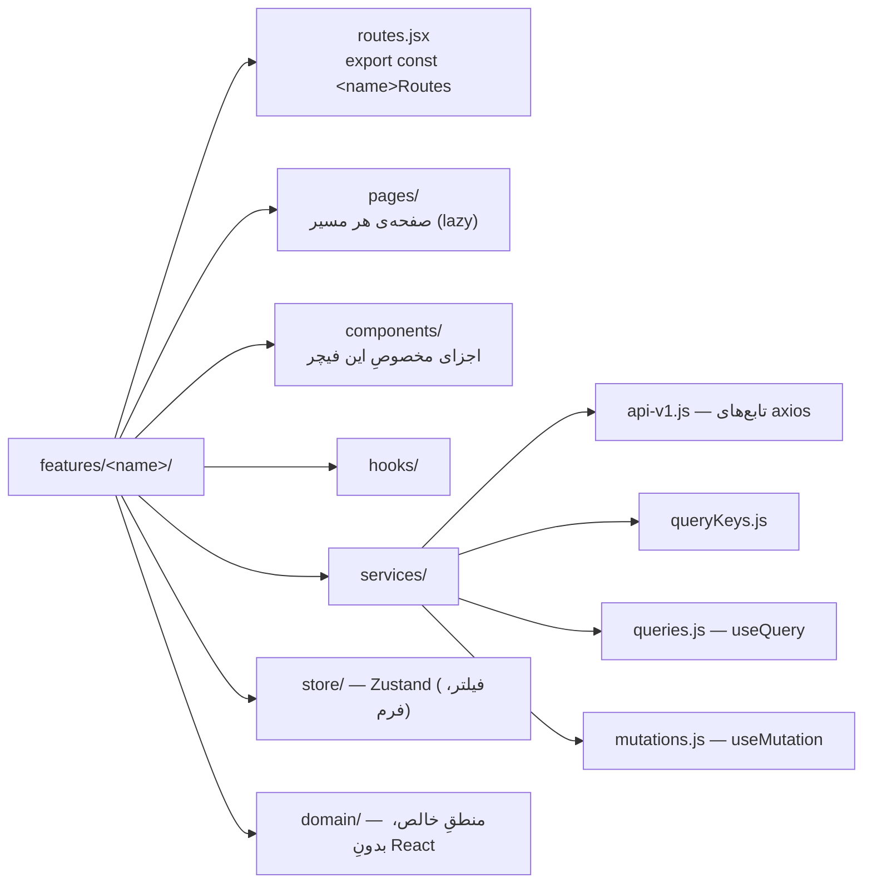
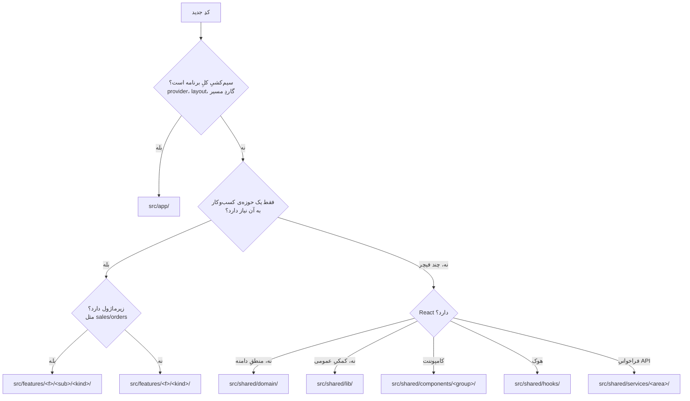

# ۰۲ — ساختارِ پوشه‌ها: کدِ جدید کجا می‌رود؟

## هدف

قبل از ساختنِ هر فایل، بدانید در کدام لایه جا می‌گیرد. `src/` سه لایه دارد: `app/` (سیم‌کشیِ برنامه)، `features/` (ماژول‌های کسب‌وکار)، `shared/` (چیزهای بی‌مالک که چند فیچر لازم دارند).

اندازه (cloc، `src/`): ۷۲۱ فایل — ۴۲۶ JSX، ۲۸۹ JS، ۶ CSS — حدود ۶۱٬۵۰۰ خطِ کد.

## فایل‌های کلیدی

- `src/main.jsx`، `src/App.jsx`، `src/index.css` — ریشه.
- `src/app/routes/routers.jsx` — تنها جایی که فیچرها به روتر وصل می‌شوند.
- `src/shared/constants/routes.js` (ثابتِ `ROUTES`) و `src/shared/constants/navigationData.js` (منوی سایدبار).

## قاعده‌ی هر لایه

### `src/app/` — فقط سیم‌کشی

**اینجا:** providerهای سراسری (`src/app/providers/AppProviders.jsx`، `QueryProvider.jsx`، `ToastProvider.jsx`)، پوسته‌ها (`src/app/layouts/AppLayout.jsx`، `AuthLayout.jsx`، `ForbiddenPage.jsx`، `NotFoundPage.jsx`، `RouteErrorPage.jsx`)، روتر و گاردها (`src/app/routes/routers.jsx`، `protectedLoader.jsx`، `PermissionGate.jsx`)، و صفحه‌های فقط-dev (`src/app/dev/StyleGuidePage.jsx`، `ComponentShowcase.jsx`).

**اینجا نه:** هیچ منطقِ کسب‌وکار یا فراخوانیِ API. سایدبار (`AppSidebar`، `NavMain`، `NavUser`، `NavWorkspace`) و `AppBreadcrumb` جزئی از پوسته‌اند و در `src/app/layouts/` هستند؛ چون `app/` مجاز است از فیچرها (مثلاً `usePermission`) import کند.

**جهتِ import:** `app/` از هر دو لایه import می‌کند؛ هیچ فایلی در `features/` یا `shared/` از `@/app/` import نمی‌کند (بررسی‌شده با grep).

### `src/features/<name>/` — یک حوزه‌ی کسب‌وکار

**اینجا:** هر چیزی که مالکش یک حوزه است: صفحه، فرم، جدول، فراخوانیِ endpointهای آن حوزه، store فیلتر/فرمِ آن.
مثال: لیستِ مشتری — `src/features/customers/pages/CustomersPage.jsx`، `components/CustomerTable.jsx`، `services/api-v1.js`، `store/customerFilterStore.js`.

**اینجا نه:** چیزی که دو فیچر به‌طورِ برابر لازم دارند و مالکِ طبیعی ندارد. مثال: منطقِ مرجوعی بینِ خرید و فروش مشترک است، پس در `src/shared/domain/returns/` است نه در `purchases/` یا `sales/`.

**چیدمانِ استاندارد** (کامل‌ترین نمونه: `src/features/customers/`):

همه‌ی پوشه‌ها اجباری نیستند؛ فقط آنچه لازم است ساخته می‌شود.

### `src/shared/` — بی‌مالک و چندبارمصرف

| زیرپوشه | چه چیزی | مثال |
| --- | --- | --- |
| `src/shared/components/ui/` | کامپوننت‌های تولیدِ shadcn — دست نزنید مگر لازم باشد | `button.jsx`، `sidebar.jsx` |
| `src/shared/components/<group>/` | کامپوننت‌های ترکیبیِ پروژه | `table/`، `filters/`، `status/`، `payments/`، `print/` |
| `src/shared/domain/` | منطقِ خالصِ مشترک (enum، محاسبه) | `enums/saleStatus.js`، `returns/`، `payments/paymentSplit.js` |
| `src/shared/services/` | API مشترک و زیرساختِ شبکه | `api/axios.js`، `files/`، `dataTransfer/`، `pos/`، `invoice/`، `returns/`، `bankAccounts/` |
| `src/shared/hooks/` | هوک‌های عمومی | `usePageHeader.js`، `useDebouncedFilters.js`، `useUrlPreset.js`، `useHideOnScroll.js` |
| `src/shared/lib/` | تابع‌های کمکیِ بی‌ربط به دامنه | `dateUtils.js`، `persianDigits.js`، `utils.js` (`cn`) |
| `src/shared/store/` | storeهای سراسری و factoryها | `headerStore.js`، `createFilterStore.js`، `printSettingsStore.js` |
| `src/shared/constants/` | `routes.js`، `navigationData.js` | — |
| `src/shared/styles/themes/` | CSSِ تمِ Material | `material.css` |

**اینجا نه:** کامپوننتی که فقط یک فیچر استفاده می‌کند. مثال: `src/features/accounting/components/AgingBar.jsx` فقط در حسابداری استفاده می‌شود و درست در همان فیچر مانده است.

## «کدِ جدید می‌نویسم؛ کجا بگذارم؟»

`<kind>` یکی از `pages`، `components`، `hooks`، `services`، `store`، `domain` است.
وقتی کدی که در یک فیچر بود فیچرِ دومی هم لازمش شد: در حالِ حاضر عرف این است که فیچرِ دوم مستقیم از فیچرِ اول import می‌کند (پایین). اگر سومین مصرف‌کننده آمد یا منطق واقعاً مالک ندارد، به `shared/` منتقل کنید.

## قراردادها و نکته‌ها

- **import بین فیچرها — وضعیتِ فعلی (نه قاعده).** شمارش = تعدادِ خطوطِ import با `@/features/<دیگر>` در فایل‌های فیچرِ واردکننده (grep، 2026-10-22):

| واردکننده | واردشده | تعداد |
| --- | --- | --- |
| `accounting` | `organization` ۲، `employees` ۲؛ `auth`، `customers`، `suppliers`، `warehouse` هر کدام ۱ | ۸ |
| `audit` | `auth` ۲، `employees` ۱ | ۳ |
| `customers` | `partyAccount` | ۹ |
| `customers` | `auth` ۱، `sales` ۱، `audit` ۱، `treasury` ۱ | ۴ |
| `dashboard` | `auth` ۳، `warehouse` ۲، `accounting` ۱، `sales` ۱ | ۷ |
| `employees` | `organization` ۶، `auth` ۳، `audit` ۲، `permissions` ۱ | ۱۲ |
| `organization` | `employees` ۷، `auth` ۲، `audit` ۲، `permissions` ۱ | ۱۲ |
| `partyAccount` | `customers` ۱، `suppliers` ۱ | ۲ |
| `permissions` | `auth` ۸، `organization` ۳، `employees` ۲ | ۱۳ |
| `purchases` | `warehouse` ۶، `suppliers` ۴، `auth` ۴، `audit` ۲، `partyAccount` ۱ | ۱۷ |
| `sales` | `warehouse` ۸، `customers` ۶، `auth` ۶، `audit` ۲، `partyAccount` ۱، `dashboard` ۱ | ۲۴ |
| `suppliers` | `partyAccount` ۹، `auth` ۱، `audit` ۱، `treasury` ۱ | ۱۲ |
| `treasury` | `sales` ۱۶، `auth` ۷، `customers` ۷، `suppliers` ۶، `partyAccount` ۴، `accounting` ۲، `purchases` ۲ | ۴۴ |
| `warehouse` | `auth` ۸، `purchases` ۷، `sales` ۵، `suppliers` ۳، `customers` ۲، `audit` ۱ | ۲۶ |

  **جهتِ عادی:** هر فیچر → `auth` (هوکِ مجوز)؛ اسناد → داده‌ی پایه (`sales`/`purchases` → `warehouse`، `customers`، `suppliers`)؛ `customers`/`suppliers` → `partyAccount`؛ گزارش‌ها (`dashboard`، `accounting`) → هر فیچری که می‌خوانند؛ صفحه‌های جزئیات → `audit` (فقط `AuditHistoryButton`/`UserActivityButton`).
  **جهتِ غیرمنتظره — اضافه نکنید:** داده‌ی پایه → اسناد یا گزارش. نمونه‌های موجود: `warehouse` → `purchases`/`sales` (کلید و `sharedInvalidation` و mutationهای مرجوعی، برای صفِ دریافت/ارسال)، `sales/installments/services/mutations.js` → `dashboardKeys` از `@/features/dashboard/services/queryKeys`، `partyAccount/services/queries.js` → `customerKeys`/`supplierKeys` (چرخه‌ی دوطرفه با `customers`/`suppliers` در سطحِ فیچر)، `customers`/`suppliers` → `treasury` (فقط `PartyOnAccountBar`) در برابرِ `treasury` → `customers`/`suppliers`، و `employees` ↔ `organization` دوطرفه. هیچ‌کدام در سطحِ فایل حلقه نمی‌سازند (madge).
- **`shared/` در ۶ فایل از `features/` import می‌کند** (خلافِ قاعده‌ی لایه‌ها؛ پیشنهادِ رفع هر کدام در [14](14-dependency-graph-and-health.md)):
  - `src/shared/services/api/axios.js` → `@/features/auth/...`
  - `src/shared/components/forms/PartyPickerCard.jsx` → `@/features/partyAccount/...`
  - `src/shared/components/forms/ProductSearchPanel.jsx`، `src/shared/components/products/ProductPicker.jsx`، `src/shared/components/products/useReturnedNewProduct.js` → `@/features/warehouse/...`
  - `src/shared/hooks/useClaimsInOtherReturns.js` → `@/features/purchases/returns/...` و `@/features/sales/returns/...`
- **زیرماژول‌ها:** در `organization`، `purchases`، `sales`، `warehouse`، و بخشی از `accounting`، هر زیرپوشه خودش چیدمانِ استاندارد را دارد و فقط یک `routes.jsx` در ریشه‌ی فیچر است:
  - `src/features/organization/` → `departments/`، `teams/` (+ `components/`، `hooks/` مشترکِ دو زیرماژول)
  - `src/features/purchases/` → `orders/`، `returns/`
  - `src/features/sales/` → `orders/`، `returns/`، `installments/`
  - `src/features/warehouse/` → `products/`، `categories/`، `units/`، `vehicles/`، `receiving/`، `shipping/`، و `shared/` (فایل‌های تخت، مثل `QueueTable.jsx`، `useQueueRows.js`؛ مشترک بینِ receiving و shipping)
  - `src/features/accounting/` چیدمانِ استاندارد دارد به‌علاوه‌ی زیرماژولِ `activity/`.
- نام‌گذاری: کامپوننت `PascalCase.jsx`، هوک `useX.js`، store `<x>Store.js` با export `use<X>Store`، factory `create<X>.js`.

## استثناها (وضعیتِ واقعی)

| فیچر | وضعیت |
| --- | --- |
| `src/features/settings/` | فقط یک صفحه: `pages/SystemSettingsPage.jsx` (`ROUTES.SETTINGS`، `lazy` + `SettingView`/`SettingManage`). |
| `src/features/partyAccount/` | `routes.jsx` و `pages/` ندارد؛ کتابخانه‌ی مشترکِ مشتری/تامین‌کننده است (`components/`، `domain/`، `services/`، `store/createPartyFilterStore.js`). |
| `src/features/auth/` | `pages/LoginPage.jsx`؛ مسیرش زیرِ `AuthLayout` است و در `routes.jsx` خودش `Suspense` دارد. |

## برای تغییرِ X، به Y بروید

| می‌خواهم… | کجا |
| --- | --- |
| فیچرِ جدید اضافه کنم | `src/features/<name>/routes.jsx` + ثبت در `src/app/routes/routers.jsx` + `ROUTES` + منو (دستورالعمل: [13-recipes.md](13-recipes.md)) |
| زیرماژول به فیچرِ موجود اضافه کنم | پوشه‌ی `src/features/<f>//` با چیدمانِ استاندارد؛ مسیرها را در `src/features/<f>/routes.jsx` اضافه کنید |
| کامپوننتی را مشترک کنم | انتقال به `src/shared/components/<group>/`؛ importهای `@/features/...` آن را حذف کنید تا قاعده‌ی لایه نشکند |
| پوسته/منوی برنامه را عوض کنم | `src/app/layouts/` (`AppLayout`، `AppSidebar`، `Nav*`، `AppBreadcrumb`) و منو در `src/shared/constants/navigationData.js` |

## سؤال‌های باز / بدهی

- importهای `shared → features` بالا مرزِ لایه را می‌شکنند؛ پیشنهاد در فایل ۱۴.
