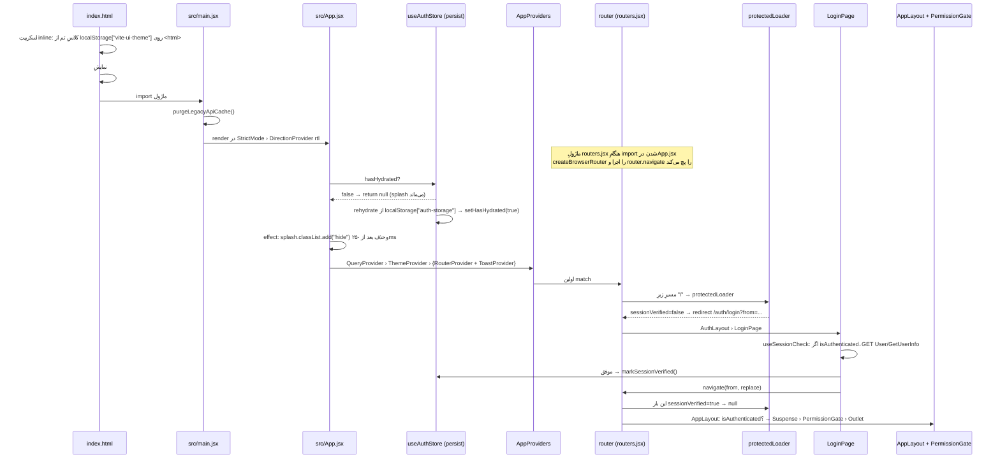
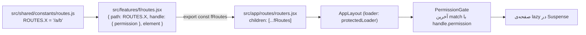

# ۰۳ — راه‌اندازی و مسیریابی

## هدف

بدانید از بازشدنِ صفحه تا رندرِ اولین صفحه چه اتفاقی می‌افتد، یک مسیر چطور تعریف و محافظت می‌شود، و برای افزودنِ صفحه‌ی جدید دقیقاً کدام فایل‌ها را عوض کنید.

## فایل‌های کلیدی

| فایل | نقش |
| --- | --- |
| `index.html` | اسکریپتِ inlineِ تم، splash (`#app-splash`)، `<script type="module" src="/src/main.jsx">` |
| `src/main.jsx` | `purgeLegacyApiCache()`، `createRoot`، `StrictMode`، `DirectionProvider direction="rtl"` |
| `src/App.jsx` | منتظرِ `hasHydrated`، محوکردنِ splash، `AppProviders` + `RouterProvider` |
| `src/app/providers/AppProviders.jsx` | ترتیبِ providerها |
| `src/app/routes/routers.jsx` | `createBrowserRouter`، ادغامِ مسیرِ فیچرها، پچِ `router.navigate` |
| `src/app/routes/protectedLoader.jsx` | loaderِ مسیرِ ریشه |
| `src/app/routes/PermissionGate.jsx` | گاردِ `handle.permission` |
| `src/app/layouts/AppLayout.jsx`، `AuthLayout.jsx` | پوسته‌ها |
| `src/shared/constants/routes.js` | ثابتِ `ROUTES` (همه‌ی آدرس‌ها) |
| `src/shared/constants/navigationData.js` | منوی سایدبار |
| `src/shared/components/layout/AppBreadcrumb.jsx` | عنوانِ breadcrumb (`ROUTE_TITLES`، `DETAIL_TITLES`) |
| `src/shared/lib/routeTransitionBus.js`، `src/shared/components/layout/RouteLoadingOverlay.jsx` | اسپینرِ جابه‌جایی |

## چطور کار می‌کند: توالیِ راه‌اندازی



نکته‌ها از کد:

- **`sessionVerified` پرسیست نمی‌شود** (`partialize` در `src/features/auth/store/authStore.js` فقط `accessToken`، `refreshToken`، `isAuthenticated` را نگه می‌دارد). پس **هر بارگذاری‌ِ کاملِ صفحه، حتی با توکنِ معتبر، یک بار از صفحه‌ی ورود رد می‌شود** تا `useSessionCheck` (`src/features/auth/services/queries.js`) توکن را با سرور بسنجد. جزئیات در [04](04-auth-and-session.md).
- `App.jsx` تا `hasHydrated` نشده `null` برمی‌گرداند تا یک فریم داشبورد قبل از ریدایرکت دیده نشود. splash در `index.html` تا آن لحظه می‌ماند.
- اسکریپتِ inlineِ `index.html` منطقِ `src/shared/components/theme/themeClasses.js` را تکرار می‌کند (کلید `"vite-ui-theme"`، پیش‌فرض `"dark"`). اگر کلید یا پیش‌فرض را در `AppProviders` عوض کنید، این اسکریپت را هم عوض کنید.

### ترتیبِ providerها و چرا

از بیرون به درون (`src/main.jsx` و `src/app/providers/AppProviders.jsx`، `src/app/layouts/AppLayout.jsx`):

1. `StrictMode`
2. `DirectionProvider direction="rtl"` (`src/shared/components/ui/direction.jsx`) — جهتِ Radix برای کلِ درخت، حتی صفحه‌ی ورود.
3. `QueryProvider` — بیرونی‌ترین providerِ برنامه؛ همه‌ی صفحه‌ها (از جمله `LoginPage` با `useSessionCheck`) به `QueryClient` نیاز دارند. چون `RouterProvider` داخلِ آن است، `queryClient` در کامپوننت‌ها هست ولی **در loaderها نیست** (loaderها بیرون از درختِ React اجرا می‌شوند؛ `protectedLoader` فقط `useAuthStore.getState()` را می‌خواند).
4. `ThemeProvider defaultTheme="dark" storageKey="vite-ui-theme"` — کلاسِ تم روی `<html>`.
5. فرزندان: `RouterProvider` و کنارش `ToastProvider`. `ToastProvider` داخلِ `ThemeProvider` است ولی به context آن وابسته نیست؛ رنگ‌هایش از متغیرهای CSSِ `--toast-*` می‌آید که فقط در تمِ Material تعریف شده‌اند (`src/shared/styles/themes/material.css`).
6. داخلِ `AppLayout` (فقط مسیرهای محافظت‌شده): `TooltipProvider` › `SidebarProvider`.

UNCLEAR: دلیلِ ترتیبِ `QueryProvider` بیرونِ `ThemeProvider` در کد کامنت نشده؛ `ThemeProvider` از React Query استفاده نمی‌کند (importهایش بررسی شد)، پس جابه‌جاییِ این دو اثری ندارد.

## چطور کار می‌کند: تعریفِ یک مسیر



1. **آدرس:** یک کلید در `ROUTES` (`src/shared/constants/routes.js`). همه‌ی مسیرهای محافظت‌شده آدرسِ مطلق می‌دهند (`"/customers"`)؛ استثنا: `invoice` و `transactions` رشته‌ی نسبی (`"invoice"`) می‌دهند و `auth` هم `"login"`.
2. **فیچر:** هر فیچر در `src/features/<f>/routes.jsx` آرایه‌ای تخت export می‌کند (`customersRoutes`، `warehouseRoutes`، …). صفحه‌ها با `lazy(() => import("./pages/X"))` بار می‌شوند. مسیرِ تو در تو (`children`) در هیچ فیچری نیست؛ تنها `index: true` در `src/features/dashboard/routes.jsx` است (`/` → `DashboardPage`).
3. **ادغام:** `src/app/routes/routers.jsx` همه را زیرِ یک شیءِ `{ path: ROUTES.ROOT, element: <AppLayout />, loader: protectedLoader, errorElement: <RouteErrorPage />, children: [{ errorElement: <RouteErrorPage />, children: [...] }] }` پخش می‌کند. routeِ بی‌مسیرِ میانی فقط برای این است که خطای رندرِ یک صفحه داخلِ پوسته (با سایدبار و هدر) نشان داده شود؛ `errorElement`ِ بیرونی خطای `protectedLoader` یا خودِ `AppLayout` را تمام‌صفحه می‌گیرد. ترتیبِ پخش اهمیتی ندارد (React Router بر اساسِ دقتِ مسیر رتبه می‌دهد).
4. **مجوز:** `handle: { permission: "CustomerView" }` یا آرایه‌ای که **هر کدام** کافی است (`satisfies` در `src/features/auth/hooks/usePermission.js`)، مثلاً `["VehicleView", "ProductCategoryView"]` در `src/features/warehouse/routes.jsx`. مسیرِ بدونِ `handle.permission` برای هر کاربرِ واردشده باز است. جزئیات در [05](05-permissions.md).
5. **Suspense:** برای مسیرهای زیرِ `AppLayout` یک `Suspense` مشترک با `ContentSpinner` در خودِ `AppLayout` هست؛ لازم نیست صفحه خودش Suspense بگذارد. زیرِ `AuthLayout` چنین چیزی نیست و `src/features/auth/routes.jsx` خودش `<Suspense fallback={null}>` می‌گذارد.

### پوسته‌ها و مسیرها

| پوسته | مسیر | مسیرهای فرزند | گارد |
| --- | --- | --- | --- |
| `AuthLayout` (`src/app/layouts/AuthLayout.jsx`) | `ROUTES.AUTH` = `/auth` | `authRoutes` (`login`) | ندارد؛ `LoginPage` خودش نشست را می‌سنجد |
| `AppLayout` (`src/app/layouts/AppLayout.jsx`) | `ROUTES.ROOT` = `/` | `dashboardRoutes`، `customersRoutes`، `employeesRoutes`، `organizationRoutes`، `permissionsRoutes`، `purchasesRoutes`، `warehouseRoutes`، `invoiceRoutes`، `salesRoutes`، `suppliersRoutes`، `accountingRoutes`، `settingsRoutes`، `transactionsRoutes` | `protectedLoader` + `isAuthenticated` در خودِ layout + `PermissionGate` |
| بدونِ پوسته | `/dev/ui` (فقط `import.meta.env.DEV`) | `StyleGuidePage` | ندارد |
| بدونِ پوسته | `*` | `NotFoundPage` | — |

`ForbiddenPage` پوسته نیست؛ `PermissionGate` آن را به جای `Outlet` رندر می‌کند. `NotFoundPage` فقط برای `*` است؛ `RouteErrorPage` (`src/app/layouts/RouteErrorPage.jsx`) با `useRouteError` پاسخِ ۴۰۴ِ روتر را به `NotFoundPage` می‌دهد و بقیه‌ی خطاها را با «بارگذاری دوباره» نشان می‌دهد (در DEV پیامِ خطا هم).

## افزودنِ صفحه یا مسیرِ جدید

نمونه‌ی واقعی: صفحه‌ی خودروها (`/warehouse/vehicles`). به ترتیب:

1. **ثابتِ آدرس** — `src/shared/constants/routes.js`:
   ```js
   WAREHOUSE_VEHICLES: "/warehouse/vehicles",
   WAREHOUSE_VEHICLES_DETAIL: "/warehouse/vehicles/:id",
   ```
2. **کامپوننتِ صفحه** — `src/features/warehouse/vehicles/pages/VehiclesPage.jsx` (default export؛ عنوانِ هدر با `usePageHeader` از `src/shared/hooks/usePageHeader.js`).
3. **ثبتِ مسیر** — `src/features/warehouse/routes.jsx`:
   ```jsx
   const VehiclesPage = lazy(() => import("./vehicles/pages/VehiclesPage"));
   // ...
   {
     path: ROUTES.WAREHOUSE_VEHICLES,
     handle: { permission: ["VehicleView", "ProductCategoryView"] },
     element: <VehiclesPage />,
   },
   ```
4. **فقط اگر فیچرِ تازه است:** `export const <f>Routes` را در `src/app/routes/routers.jsx` import و در `children` پخش کنید.
5. **کلیدِ مجوز** — نامِ یک عضوِ `PermissionEnum` در `../Backend-Net/Domain/Enums/PermissionEnum.cs`؛ فرانت فهرستِ ثابتی ندارد، پس نام را از همان فایل کپی کنید. ببینید [05](05-permissions.md).
6. **منو** — `src/shared/constants/navigationData.js`، زیرِ `items` گروهِ مربوط: `{ title, url: ROUTES.WAREHOUSE_VEHICLES, permission: [...], icon: Car, description }`. همان `permission`ِ مسیر را بدهید تا منو و گارد هم‌خوان باشند.
7. **breadcrumb** — `ROUTE_TITLES` در `src/shared/components/layout/AppBreadcrumb.jsx`؛ برای صفحه‌ی جزئیات با `:id`، کلیدِ والد را در `DETAIL_TITLES` بگذارید. خودروها هر دو را دارند (`ROUTES.WAREHOUSE_VEHICLES` → «خودروها» و «جزئیات خودرو»).

## مسیرِ «navigation settled»: اسپینرِ جابه‌جایی

**مسئله:** صفحه‌ها lazy هستند؛ بینِ کلیک و آمدنِ صفحه‌ی تازه (دانلودِ chunk) هیچ بازخوردی نیست و کاربر دوباره کلیک می‌کند. React Router به‌روزرسانی را در transition می‌گذارد، پس `useLocation()` تا رندرِ صفحه‌ی تازه مسیرِ قبلی را نشان می‌دهد.

**فرستنده:** `src/app/routes/routers.jsx` متدِ `router.navigate` را پچ می‌کند (هم `<Link>` و هم `useNavigate()` آن را صدا می‌زنند). اگر مقصد (`resolveTargetPathname(to)`) با مسیرِ فعلی فرق کند `notifyNavigationStart()` را صدا می‌زند و شماره‌ی ناوبری می‌گیرد؛ وقتی promiseِ `originalNavigate` تمام شد `notifyNavigationSettled(id, router.state.location.pathname)`.

**گذرگاه:** `src/shared/lib/routeTransitionBus.js` — دو `Set` از listenerها و `latestId`؛ گزارشِ «تمام شد»ِ ناوبریِ قدیمی‌تر از `latestId` نادیده گرفته می‌شود.

**شنونده:** `RouteLoadingOverlay` (`src/shared/components/layout/RouteLoadingOverlay.jsx`)، که در `AppLayout` (با `contained`) و `AuthLayout` رندر می‌شود. با `onNavigationStart` روشن، و وقتی خاموش می‌شود که (الف) `location.pathname` عوض شود، یا (ب) مسیرِ settled همان مسیرِ فعلی باشد (ناوبری با `useBlocker` متوقف شد)، یا (ج) `MAX_VISIBLE_MS` = ۱۵ ثانیه بگذرد. عمداً منتظرِ داده‌ی صفحه نمی‌ماند.

**نکته‌ها:**
- `navigate(-1)` (عدد) شروع را اعلام می‌کند ولی settled گزارش نمی‌شود؛ خاموش‌شدن به تغییرِ `location.pathname` بستگی دارد. اگر برگشت به همان مسیر برسد، اسپینر تا ۱۵ ثانیه می‌ماند.
- تغییرِ فقط query string (`?tab=…`) اسپینر را روشن نمی‌کند چون فقط `pathname` مقایسه می‌شود.
- دکمه‌ی back/forwardِ خودِ مرورگر از `router.navigate` نمی‌گذرد و اسپینر ندارد.
- هر کدی که `router.navigate` را دور بزند (مثلاً `window.location.href = ROUTES.LOGIN` در `src/shared/services/api/axios.js`) بارگذاریِ کاملِ صفحه است، نه ناوبریِ روتر.

## برای تغییرِ X، به Y بروید

| می‌خواهم… | کجا |
| --- | --- |
| صفحه‌ی جدید | بخشِ «افزودنِ صفحه یا مسیرِ جدید» بالا |
| صفحه‌ی ۴۰۴ | `src/app/layouts/NotFoundPage.jsx` |
| صفحه‌ی خطای رندر/loader | `src/app/layouts/RouteErrorPage.jsx` |
| صفحه‌ی «دسترسی ندارید» | `src/app/layouts/ForbiddenPage.jsx` |
| هدر/سایدبارِ پوسته | `src/app/layouts/AppLayout.jsx`؛ عنوانِ صفحه از `useHeaderStore` (`src/shared/store/headerStore.js`) |
| رفتارِ اسپینرِ جابه‌جایی | `src/shared/components/layout/RouteLoadingOverlay.jsx` |
| مقصدِ پیش‌فرض بعد از ورود | `from` در `src/features/auth/pages/LoginPage.jsx` (پیش‌فرض `ROUTES.DASHBOARD`) |
| splash یا رنگِ پیش از React | `index.html` |

## سؤال‌های باز / بدهی

- **`settings/` نه `lazy()` دارد نه `handle.permission`** (`src/features/settings/routes.jsx`): ۹ صفحه‌ی placeholder در باندلِ اصلی هستند و برای هر کاربرِ واردشده باز. همین‌طور `src/features/invoice/routes.jsx` و `src/features/transactions/routes.jsx` (import مستقیم، بدونِ مجوز). `src/features/dashboard/routes.jsx` هم مجوز ندارد (احتمالاً عمدی؛ داشبورد برای همه).
- `ROUTE_TITLES`ِ `AppBreadcrumb.jsx` کلیدهایی دارد که هیچ مسیرِ ثبت‌شده‌ای ندارند: `INVOICE_LIST`، `INVOICE_NEW`، `TRANSACTIONS_BUY_SELL`، `TRANSACTIONS_PAYMENTS`، `TRANSACTIONS_RETURNS`، `WAREHOUSE_STOCK`، `WAREHOUSE_TRANSACTIONS`، `TOOLS_NUMBER_TO_WORDS`، `TOOLS_CALENDAR`، `FEEDBACK` (همه در `ROUTES` تعریف شده‌اند — بررسی‌شده؛ فقط صفحه ندارند). همه‌ی `ROUTES.*`ِ به‌کاررفته در `AppBreadcrumb.jsx`، `navigationData.js` و `routes.jsx`ها در `src/shared/constants/routes.js` وجود دارند.
- هر بارگذاریِ کامل از صفحه‌ی ورود رد می‌شود (طراحیِ عمدی، ولی URL برای یک لحظه به `/auth/login?from=` می‌رود).
- منطقِ تم در `index.html` و `themeClasses.js` دو نسخه است.
