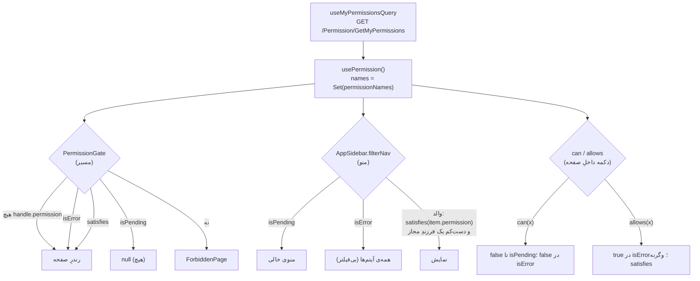

# ۰۵ — مجوزها (Permissions)

## هدف

بدانید یک صفحه، آیتمِ منو یا دکمه چطور به مجوز گره می‌خورد، نام‌های مجوز از کجا می‌آیند، و صفحه‌های مدیریتِ مجوز (کارمند و الگوی واحد) چطور کار می‌کنند.

> همه‌ی بررسی‌های فرانت فقط UX هستند. کنترلِ واقعی روی هر endpoint در سرور است (کامنتِ `PermissionGate.jsx` و `usePermission.js`).

## فایل‌های کلیدی

| فایل | نقش |
| --- | --- |
| `src/features/auth/hooks/usePermission.js` | `satisfies(names, required)` و `usePermission()` → `{ isPending, isError, names, can, canAny, allows }` |
| `src/features/auth/services/queries.js` | `useMyPermissionsQuery` — `GET /Permission/GetMyPermissions`، `staleTime` ۵ دقیقه |
| `src/app/routes/PermissionGate.jsx` | گاردِ مسیر بر اساسِ `handle.permission` |
| `src/shared/components/layout/AppSidebar.jsx` | `filterNav` — فیلترِ منو |
| `src/shared/constants/navigationData.js` | `permission` روی هر زیرآیتمِ منو |
| `src/features/*/routes.jsx` | `handle: { permission }` روی هر مسیر |
| `src/features/permissions/` | صفحه‌های مدیریتِ دسترسی |
| `../Backend-Net/Domain/Enums/PermissionEnum.cs` | منبعِ نام‌ها (بیرون از `Frontend/`) |
| `src/features/auth/hooks/useFeatureFlags.js` | سوییچ‌های قابلیت: `flagIsOn(flags, key)` و `useFeatureFlags()` → `{ isPending, isError, isOn, value }` |

## چطور کار می‌کند

### مدلِ داده

`GetMyPermissions` شیئی با `permissionNames` می‌دهد؛ `usePermission` آن را به `Set` تبدیل می‌کند. شرط‌ها روی **نام** هستند (`"SaleView"`) نه عدد. یک شرط یکی از این‌هاست (`satisfies`):

- `null`/`undefined` → همیشه true
- یک رشته → باید در `names` باشد
- آرایه → **هر کدام** کافی است (any-of)؛ آرایه‌ی خالی → true

شرطِ «همه‌ی این‌ها» (all-of) وجود ندارد.

### جریانِ بررسی در سه نقطه



1. **مسیر** — `PermissionGate` (داخلِ `AppLayout`) آخرین routeِ `useMatches()` را که `handle.permission` دارد پیدا می‌کند (`matches.findLast`). در خطای شبکه صفحه باز می‌شود و سرور ۴۰۳ می‌دهد.
2. **منو** — `filterNav` در `AppSidebar.jsx` (در `isError` اصلاً فیلتر نمی‌شود، هم‌خوان با گارد و `allows`): آیتمِ بی‌فرزند اگر `permission`ش برآورده شود دیده می‌شود؛ والد فقط وقتی دیده می‌شود که دست‌کم یک فرزندِ مجاز داشته باشد. والدها خودشان `permission` ندارند.
3. **داخلِ صفحه** — دو شکل در کد هست:

```jsx
// src/features/sales/orders/pages/SaleIssuedView.jsx
const { allows } = usePermission();
const canUpdate = allows("SaleUpdate");
// ...
{plan && allows("SaleInstallmentView") && <InstallmentPlanCard saleId={sale.id} />}

// src/features/warehouse/units/pages/UnitsPage.jsx — همان رفتارِ allows، دستی
const { can, isError: permissionsUnknown } = usePermission();
const canManage = permissionsUnknown || can("ProductUnitManage");
```

### صفحه‌های مدیریتِ دسترسی (`src/features/permissions/`)

| مسیر (`ROUTES`) | صفحه | مجوز |
| --- | --- | --- |
| `ACCESS` → ریدایرکت به `ACCESS_USERS` | — | — |
| `ACCESS_USERS`، `ACCESS_USERS_DETAIL` | `pages/UserAccessPage.jsx` | `PermissionView` |
| `ACCESS_TEMPLATES`، `ACCESS_TEMPLATES_DETAIL` | `pages/DepartmentTemplatesPage.jsx` | `PermissionView` |

مسیرِ لیست و جزئیات هر دو همان کامپوننت را رندر می‌کنند؛ `:id` فقط انتخاب را تعیین می‌کند تا لیست دوباره بار نشود.

endpointها (`src/features/permissions/services/api-v1.js`): `getUserPermissions` (`GET /Permission/GetUserPermissions`)، `updateUserPermissions` (`PUT /Permission/UpdateUserPermissions`)، `getDepartmentPermissionTemplate`، `updateDepartmentPermissionTemplate`.

نکته‌های این صفحه‌ها:
- **کاتالوگ از سرور می‌آید**: `permissionGroups` در پاسخِ `GetUserPermissions` همان چیزی است که درخواست‌دهنده اجازه‌ی دیدنش را دارد؛ چک‌باکس‌ها از آن ساخته می‌شوند و در فرانت هاردکد نیستند. در این صفحه‌ها با **عدد** (`permission`) کار می‌شود، نه نام.
- ذخیره **جایگزینیِ کامل** است: `permissions` فهرستِ نهایی است؛ آرایه‌ی خالی یعنی همه گرفته شود.
- `usePermissionDraft` (`src/features/permissions/hooks/usePermissionDraft.js`) فقط یک بار از سرور مقدار می‌گیرد تا refetchِ پس‌زمینه تیک‌های ذخیره‌نشده را پاک نکند؛ `commit(saved)` بعد از ذخیره. کمک‌تابع‌های مجموعه در `src/features/permissions/components/permissionSets.js`.
- `useUpdateUserPermissionsMutation` (`src/features/permissions/services/mutations.js`) بعد از موفقیت `permissionKeys.user(userId)` **و** `authKeys.myPermissions()` را invalidate می‌کند تا اگر ادمین مجوزِ خودش را عوض کرد، منو و گارد فوراً تازه شوند.

### سوییچ‌های قابلیت (Feature flags)

محورِ دوم، جدا از دسترسی: بعضی قابلیت‌ها با یک تنظیمِ سامانه روشن/خاموش می‌شوند (مثلاً `Warehouse.MultiWarehouseEnabled`). `GET /Setting/GetFeatureFlags` (بدونِ دسترسیِ خاص) تنظیم‌های `isPublic`ِ کاتالوگِ سرور را به شکلِ نگاشتِ کلید ← مقدارِ تایپ‌شده می‌دهد.

- `useFeatureFlagsQuery` در `src/features/auth/services/queries.js` (کلید `authKeys.featureFlags()`، `staleTime` ۵ دقیقه)؛ `useUpdateSystemSettingsMutation` بعد از ذخیره invalidateاش می‌کند.
- `useFeatureFlags().isOn(key)`: کلیدِ خالی ← true؛ کلیدِ نیامده یا ناشناخته ← **خاموش** (همان پیش‌فرضِ سرور).
- منو: `featureFlag` روی والد یا زیرآیتمِ `navigationData.js`؛ `filterNav` هم دسترسی و هم سوییچ را می‌سنجد. سوییچ برخلافِ دسترسی در `isError` هم اعمال می‌شود.
- مسیر گاردِ سوییچ ندارد؛ سرور خودش قاعده را اعمال می‌کند (مثلاً ثبتِ حواله با چندانبارِ خاموش ۴۰۰ می‌دهد).

## قراردادها و نکته‌ها

- نام‌ها باید دقیقاً اعضای `PermissionEnum` در `../Backend-Net/Domain/Enums/PermissionEnum.cs` باشند. همه‌ی ۴۹ نامِ متمایزی که الان در `src/` به شکلِ `permission: …`، `can(…)` یا `allows(…)` آمده‌اند (`routes.jsx`ها، `navigationData.js`، صفحه‌ها) در آن enum وجود دارند (بررسی‌شده با grep). فهرستِ ثابتی از نام‌ها در فرانت نیست؛ غلطِ تایپی فقط با این بررسی پیدا می‌شود.
- `permission`ِ منو و `handle.permission`ِ مسیر را یکسان بگذارید؛ هیچ چیزی این را اجباری نمی‌کند.
- برای دکمه‌ها `allows` را ترجیح دهید (در خطا دکمه پنهان نمی‌شود). `can` در `isPending` و `isError` false می‌دهد.
- `canAny(...)` تعریف شده ولی هیچ‌جا استفاده نمی‌شود (۰ فراخوانی)؛ `can([...])` همان کار را می‌کند.
- `src/features/accounting/routes.jsx` یک `reportHandle = { permission: "ReportView" }` مشترک برای چند مسیر دارد — الگوی خوب برای گروهِ مسیرهای هم‌مجوز.

## برای تغییرِ X، به Y بروید

| می‌خواهم… | کجا |
| --- | --- |
| صفحه‌ای را محافظت کنم | `handle: { permission: "X" }` در `src/features/<f>/routes.jsx` |
| کامپوننتی که خودش مجوزش را می‌سنجد | الگو: `AuditHistoryButton` (`AuditLogView`) در `src/features/audit/components/AuditHistoryButton.jsx` — بی‌مجوز `null` |
| آیتمِ منو را محدود کنم | `permission` روی زیرآیتم در `src/shared/constants/navigationData.js` |
| آیتم/بخشی را به سوییچِ قابلیت ببندم | منو: `featureFlag: "<کلید>"` در `navigationData.js`؛ داخلِ صفحه: `useFeatureFlags().isOn("<کلید>")` |
| دکمه‌ای را محدود کنم | `const { allows } = usePermission()` از `@/features/auth/hooks/usePermission`؛ الگو: `src/features/sales/orders/pages/SaleIssuedView.jsx` |
| مجوزِ تازه (سمتِ سرور) | فرانت نمی‌سازد؛ در `Backend-Net/docs/frontend-requests.fa.md` درخواست بنویسید، بعد نامش را مصرف کنید |
| ظاهرِ «دسترسی ندارید» | `src/app/layouts/ForbiddenPage.jsx` |
| ویرایشگرِ چک‌باکس‌ها | `src/features/permissions/components/PermissionEditor.jsx` |

## سؤال‌های باز / بدهی

- مسیرهای `settings`، `invoice`، `transactions` و `dashboard` هیچ `handle.permission` ندارند (فایل ۰۳).
- `canAny` بی‌استفاده است.
- هیچ اعتبارسنجیِ خودکاری بینِ نام‌های فرانت و `PermissionEnum.cs` نیست؛ پیشنهاد در فایل ۱۴.
