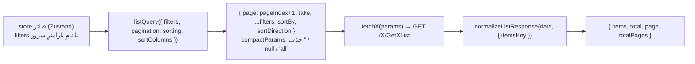
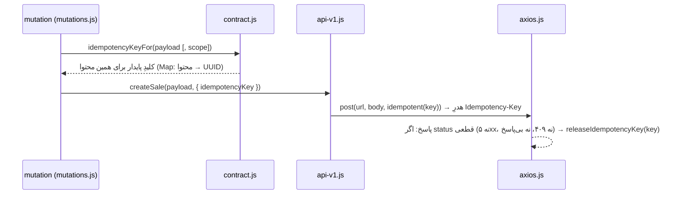

# ۰۶ — لایه‌ی API

## هدف

بدانید یک endpointِ بکند را چطور صدا بزنید: کدام نمونه‌ی axios، چه شکلی از پاسخ برمی‌گردد، پارامترهای فهرست چطور ساخته می‌شوند، خطا چطور به پیامِ فارسی تبدیل می‌شود، و کِی کلیدِ ایدمپوتنسی لازم است.

## فایل‌های کلیدی

| فایل | export‌های اصلی |
| --- | --- |
| `src/shared/services/api/axios.js` | `default` = `axiosInstance` (همه‌ی درخواست‌ها از این) |
| `src/shared/services/api/contract.js` | `normalizeListResponse`، `compactParams`، `listQuery`، `MAX_PAGE_SIZE`، `fetchAllPages`، `idempotencyKeyFor`، `releaseIdempotencyKey`، `idempotent`، `documentVersion`، `toApiAttachments` |
| `src/shared/services/api/sorting.js` | `SortDirectionEnum`، `toApiSort` |
| `src/shared/services/api/blob.js` | `unwrapBlobError` |
| `src/shared/lib/errorMessage.js` | `ERROR_MESSAGES`، `extractServerMessage`، `getErrorMessage`، `isUserFacingMessage` |
| `src/features/**/services/api-v1.js` و `src/shared/services/*/api-v1.js` | ۲۶ فایل؛ یک فایل برای هر کنترلرِ بکند |
| `../Backend-Net/docs/api-guide.fa.md` | مرجعِ endpointها (کامنتِ `api-v1`ها به «بخش N» آن ارجاع می‌دهند) |

## چطور کار می‌کند

### ۱. نمونه‌ی axios

`axiosInstance` با `baseURL = VITE_API_BASE_URL || "http://localhost:5083/api"`، `timeout` = `VITE_API_TIMEOUT` یا ۱۵۰۰۰، و `paramsSerializer: { indexes: null }` (آرایه به شکلِ `statuses=2&statuses=3` که ASP.NET برای `List<>` می‌خواند).

**interceptorِ درخواست:**
1. `Authorization: Bearer <useAuthStore.getState().accessToken>`.
2. اگر `config.data` یک `FormData` است، `Content-Type` حذف می‌شود؛ وگرنه هدرِ پیش‌فرضِ `application/json` باعث می‌شد axios بدنه را به JSON تبدیل کند و فایل ارسال نشود.

**interceptorِ پاسخ (موفق):**
1. `releaseKeyIfSettled` — کلیدِ ایدمپوتنسی را آزاد می‌کند (پایین).
2. اگر بدنه پوشش است (`isEnvelope`: شیء با `Data`/`data` **و** `Message`/`message`)، `response.data` با `Data` جایگزین می‌شود.

پس در `api-v1` همیشه `const { data } = await axiosInstance.get(...)` و `data` همان `Data`ِ سرور است.

**interceptorِ پاسخ (خطا):** ۴۰۱ → صفِ refresh ([04](04-auth-and-session.md)). بقیه → `attachUserMessage(error)`: `error.serverMessage = extractServerMessage(response.data)` و `error.message = getErrorMessage(error)`. در dev، ۴۲۲ (کلیدِ تکراری برای درخواستِ متفاوت) در کنسول خطا چاپ می‌کند.

### ۲. شکلِ یک فایلِ `api-v1.js`

الگو: `src/features/customers/services/api-v1.js`.

```js
export const CUSTOMER_SORT_COLUMNS = { id: 0, fullName: 2 }; // CustomerListSortEnum

export async function fetchCustomers(params) {
  const { data } = await axiosInstance.get("/Customer/GetCustomerList", { params });
  return normalizeListResponse(data, { itemsKey: "customerList" });
}

export const updateCustomer = async (id, updatedData) => {
  const { data } = await axiosInstance.put("/Customer/UpdateCustomer", { id, ...updatedData });
  return data;
};
```

- آدرس‌ها REST نیستند: `/<Controller>/<Action>` (مثل `/Customer/GetCustomerDetail`). شناسه در **query یا بدنه** می‌رود، نه در مسیر.
- نامِ فیلدها همان نامِ بکند است؛ adapterِ تغییرِ نام نسازید. تبدیلِ واقعی (ساختنِ payload) در تابع‌های `toApi*` کنارِ همان فایل است، مثل `toApiSalePayload` در `src/features/sales/orders/services/api-v1.js`.

### ۳. فهرست‌ها: پارامتر، مرتب‌سازی، صفحه‌بندی



- `listQuery` (`contract.js`) صفحه را ۱-مبنا می‌کند و `toApiSort(sorting, sortColumns)` شناسه‌ی ستونِ جدول را به عددِ `*ListSortEnum` تبدیل می‌کند (`SortDirectionEnum`: `ASC: 0`، `DESC: 1`). ستونِ غایب از نقشه = ترتیبِ پیش‌فرضِ سرور.
- `compactParams` مقدارهای `""`، `null`، `undefined` و `"all"` را حذف می‌کند، چون سرور فیلترِ خالی را «فیلتر روی مقدارِ خالی» می‌فهمد.
- `normalizeListResponse` پاسخِ `{ customerList, Page: { Page, PageCount, Take, Total } }` (هر دو حالتِ PascalCase/camelCase) را به `{ items, total, page, totalPages }` تبدیل می‌کند. بی `itemsKey`، اولین آرایه‌ی پاسخ برداشته می‌شود.
- `fetchAllPages(fetchPage, { itemsKey })` برای انتخابگرهایی که کلِ فهرست را لازم دارند: صفحه‌ی اول، بعد بقیه با حداکثر ۴ درخواستِ هم‌زمان. `MAX_PAGE_SIZE = 200`.

### ۴. ایدمپوتنسی (عملیاتِ نوشتنِ مالی/موجودی)



- کلید به **محتوای** درخواست بسته است (`JSON.stringify(variables)`)، پس کلیکِ دوباره بعد از timeout همان کلید را می‌فرستد و سرور دوبار ثبت نمی‌کند. بعد از پاسخِ قطعی کلید آزاد می‌شود تا دو سندِ عیناً یکسانِ عمدی هم ممکن باشد.
- `scope` برای وقتی است که دو قصدِ جدا محتوای یکسان دارند (مثلاً `operation.id` در `src/shared/services/documentChanges.js`).
- کلید در **لایه‌ی mutation** ساخته می‌شود؛ `api-v1` فقط `{ idempotencyKey }` می‌گیرد و `idempotent(key)` را به config می‌دهد. نمونه: `createSale` در `src/features/sales/orders/services/api-v1.js` و `useCreateSaleMutation` در `src/features/sales/orders/services/mutations.js`.
- `QueryProvider` mutationها را فقط روی ۴۰۹ تا ۳ بار تکرار می‌کند ([07](07-server-state-react-query.md)).
- الان در ۱۰ فایل استفاده می‌شود: mutationهای خرید، فروش، اقساط، دریافت، ارسال، دانه‌ها، `createReturnMutations.js`، `documentChanges.js`، `dataTransfer/mutations.js`.

### ۵. پیامِ خطا

همیشه با `getErrorMessage(error, fallback)` نمایش دهید. ترتیب: (۱) `error.serverMessage` (فقط اگر حرفِ فارسی دارد)، (۲) قطعیِ شبکه/timeout/لغو، و ۴۰۱/۴۰۳/۴۱۳/۴۲۹ با متنِ مخصوص، (۳) `fallback`، (۴) پیامِ عمومیِ کدِ وضعیت. `extractServerMessage` هم `ResponseDto.Message` و هم اولین پیامِ `errors`ِ `ProblemDetails` را می‌شناسد.

```js
onError: (error) => toast.error(getErrorMessage(error, "خطا در ثبت دسترسی‌ها")),
```

### ۶. دانلود (Blob)

با `responseType: "blob"` بدنه‌ی خطا هم Blob است و interceptor پیام را نمی‌خواند؛ `.catch(unwrapBlobError)` آن را باز می‌کند. استفاده: `src/shared/services/invoice/api-v1.js`، `src/shared/services/dataTransfer/api-v1.js`. ذخیره‌ی فایل: `src/shared/lib/saveBlob.js`.

## قراردادها و نکته‌ها

- **هرگز axiosِ خام import نکنید**؛ همیشه `import axiosInstance from "@/shared/services/api/axios"` (تنها استثنا درخواستِ refresh در خودِ `axios.js`).
- timeoutِ اختصاصی برای درخواست‌های کند در خودِ تابع: `login` ۴۵ ثانیه، `src/shared/services/invoice/api-v1.js` ۶۰ ثانیه (فقط PDFها؛ داده‌ی JSONِ سند با timeoutِ پیش‌فرض)، `src/shared/services/files/api-v1.js` ۱۲۰ ثانیه، `FILE_TIMEOUT` در `src/shared/services/dataTransfer/api-v1.js`.
- `ResponseMessageType` در پوشش خوانده نمی‌شود؛ موفقیت/شکست فقط از کدِ HTTP است.
- کامپوننت‌ها `api-v1` را مستقیم صدا نمی‌زنند؛ از هوک‌های `queries.js`/`mutations.js` استفاده می‌کنند (فایل ۰۷).

## برای تغییرِ X، به Y بروید

| می‌خواهم… | کجا |
| --- | --- |
| endpointِ تازه صدا بزنم | `api-v1.js`ِ همان فیچر (یا `src/shared/services/<area>/api-v1.js` اگر مشترک است)؛ الگو: `src/features/customers/services/api-v1.js` |
| فهرستِ صفحه‌بندی‌شده با فیلتر/مرتب‌سازی | `listQuery` + `<X>_SORT_COLUMNS` + `normalizeListResponse`؛ الگو: `useCustomersQuery` در `src/features/customers/services/queries.js` |
| نوشتنی که نباید دوبار ثبت شود | `idempotencyKeyFor` در mutation + `idempotent(key)` در api؛ الگو: `createSale` |
| آپلودِ فایل | `FormData` بفرستید؛ interceptor هدر را درست می‌کند. الگو: `src/shared/services/files/api-v1.js` |
| متنِ خطاهای عمومی | `ERROR_MESSAGES` در `src/shared/lib/errorMessage.js` |
| شکلِ پوشش یا هدرِ سراسری | `src/shared/services/api/axios.js` |

## سؤال‌های باز / بدهی

- `keysByContent` در `contract.js` یک `Map`ِ سراسری است که فقط با پاسخِ قطعی خالی می‌شود؛ درخواستی که هرگز پاسخ نگیرد کلیدش تا بارگذاریِ بعدی می‌ماند (عمدی، برای تکرار؛ فقط حافظه).
- `isEnvelope` به وجودِ هم‌زمانِ `Data` و `Message` تکیه دارد؛ endpointی که شیئی با همین دو کلید به‌عنوانِ داده برگرداند اشتباه باز می‌شود. UNCLEAR: موردی پیدا نشد؛ فقط ریسک است.
- `src/shared/services/api/axios.js` به `@/features/auth/store/authStore` وابسته است (مرزِ لایه؛ فایل ۱۴).
