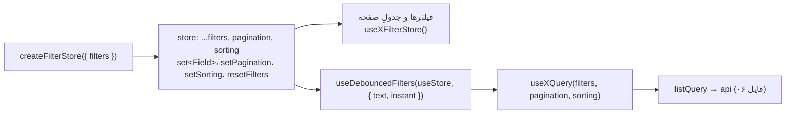

# ۰۸ — state کلاینت: Zustand و فرم‌ها

## هدف

بدانید stateی که از سرور نمی‌آید کجا نگه داشته می‌شود: فیلتر و صفحه‌بندیِ لیست‌ها، فرمِ سندِ خرید/فروش، پیش‌نویسِ فرم‌های کوچک، و عنوانِ هدر. و برای فرمِ جدید بین Zustand و react-hook-form درست انتخاب کنید.

> قاعده: داده‌ی سرور در React Query است ([07](07-server-state-react-query.md))؛ هیچ storeی کپیِ داده‌ی سرور نگه نمی‌دارد، جز پیش‌نویسِ فرمی که از سند پر شده.

## فایل‌های کلیدی

| فایل | export |
| --- | --- |
| `src/shared/store/createFilterStore.js` | `createFilterStore({ filters, defaultSorting, defaultPageSize, actions })` |
| `src/shared/store/createDocumentFormStore.js` | `createDocumentFormStore({ emptyForm, formFromDocument })`، `isDocumentFormChanged` |
| `src/shared/store/formDraftStore.js` | `useFormDraftStore` (پیش‌نویسِ یک‌بارمصرف) |
| `src/shared/store/headerStore.js` | `useHeaderStore` (`title`، `showBack`، `onBack`، `actionsSlot` — گرهِ DOMِ جای دکمه‌های صفحه در هدر) |
| `src/shared/hooks/useDebouncedFilters.js` | `useDebouncedFilters(useStore, { text, instant })` |
| `src/shared/hooks/useDocumentFormDraft.js` | چرخه‌ی پرکردنِ فرمِ سند |
| `src/shared/hooks/useFormDraft.js` | خواندن/ذخیره‌ی پیش‌نویس با `useFormDraftStore` |
| `src/shared/hooks/useSubPageNavigation.js` | رفتن به صفحه‌ی فرعی («کالای جدید») و برگشت |
| `src/shared/hooks/usePageHeader.js` | تنظیمِ هدر از صفحه |
| `src/features/partyAccount/store/createPartyFilterStore.js` | factoryِ فیلترِ مشتری/تامین‌کننده |

## فهرستِ storeها

| نوع | فایل‌ها |
| --- | --- |
| سراسری | `src/features/auth/store/authStore.js` (persist، [04](04-auth-and-session.md))، `src/shared/store/headerStore.js`، `src/shared/store/formDraftStore.js`، `src/shared/store/printSettingsStore.js` (persist) |
| فیلترِ لیست (`createFilterStore`) | `*FilterStore.js` در `customers`، `suppliers`، `employees`، `organization/departments`، `organization/teams`، `purchases/orders`، `purchases/returns`، `sales/orders`، `sales/returns`، `sales/installments`، `warehouse/products`، `warehouse/receiving`، `warehouse/shipping`، `warehouse/units`، `accounting/activity`؛ و بخشی از `src/features/accounting/store/accountingFilterStores.js` |
| فیلترِ بدونِ factory (`create` + `devtools`) | `src/features/dashboard/store/dashboardFilterStore.js` (طبقِ کامنتش چون صفحه‌بندی ندارد) و یک store در انتهای `accountingFilterStores.js` |
| فرمِ سند (`createDocumentFormStore`) | `src/features/purchases/orders/store/purchaseFormStore.js`، `src/features/sales/orders/store/saleFormStore.js` |
| فرمِ دستی (`create` مستقیم) | `src/features/purchases/returns/store/purchaseReturnFormStore.js`، `src/features/sales/returns/store/salesReturnFormStore.js`، `src/features/warehouse/receiving/store/receivingFormStore.js`، `src/features/warehouse/shipping/store/shippingFormStore.js` |
| persist در localStorage | `authStore` (`auth-storage`)، `src/features/dashboard/store/dashboardLayoutStore.js` (`dashboard-layout`)، `src/features/warehouse/units/store/unitFilterStore.js` (`unit-label-template`)، `src/shared/store/printSettingsStore.js` (`print-settings`؛ تنظیماتِ چاپِ هر نوع برگه، فقط تغییرها) |

## چطور کار می‌کند

### ۱. فیلترِ لیست



- برای هر کلیدِ `filters` اکشنِ `set<Field>` ساخته می‌شود که مقدار را می‌گذارد **و** `pageIndex` را صفر می‌کند. `setSorting` هم به صفحه‌ی اول برمی‌گردد؛ `pageSize` دست نمی‌خورد.
- پیش‌فرض‌ها: `pageSize` ۱۰، `sorting` `{ id: "createdAt", desc: true }`.
- `actions: ({ set, applyFilters }) => ({...})` برای اکشن‌های ترکیبی (بازه‌ی قیمت، میان‌برها).
- `useStore.filterDefaults = filters` — برای شمارشِ فیلترهای فعال (`src/shared/hooks/useActiveFilterCount.js`).
- **نامِ فیلدها همان نامِ پارامترِ سرور است** (`fullName`، `minBalance`)، پس بینِ store و درخواست ترجمه‌ای نیست.
- `useDebouncedFilters` فقط فیلدهای `text` را با تأخیر می‌دهد؛ `instant` (select، تاریخ) فوری.

```js
// src/features/customers/services/queries.js
export function useCustomerListFilters() {
  return useDebouncedFilters(useCustomerFilterStore, {
    text: ["fullName", "id", "minBalance", "maxBalance"],
    instant: ["balanceType"],
  });
}
```

storeِ فیلتر در حافظه است: رفتن به صفحه‌ی جزئیات و برگشت فیلترها را نگه می‌دارد؛ بارگذاریِ کاملِ صفحه پاکشان می‌کند.

### ۲. فرمِ سندِ خرید/فروش

چرا store و نه state کامپوننت: کاربر وسطِ فرم به «کالای جدید» یا «مشتری جدید» می‌رود و برمی‌گردد؛ فرم نباید پاک شود.

`createDocumentFormStore({ emptyForm, formFromDocument })` می‌سازد: `formData`، `baseline`، `initializedForId`، و `setFormData`، `setItems`، `setPaymentDraft`، `initializeForNew`، `initializeFrom(doc)`، `resetForm`.

`useDocumentFormDraft(doc, store)` (`src/shared/hooks/useDocumentFormDraft.js`):

1. `version = doc ? \`${doc.id}:${doc.updatedAt}\` : "new"`.
2. سندِ موجود → `initializeFrom(doc)`؛ فقط وقتی فرم دوباره پر می‌شود که `version` عوض شود، پس ویرایش‌های ذخیره‌نشده با برگشت از صفحه‌ی فرعی می‌مانند.
3. سندِ تازه → اگر کاربر از صفحه‌ی فرعی برنگشته (`useSubPageNavigation().cameBack`)، `resetForm()`؛ بعد `initializeForNew()`.
4. `ready = initializedForId === version` — تا `ready` نشده فرم را رندر نکنید.

`isDocumentFormChanged` (سلکتور) فرم را با `baseline` مقایسه می‌کند؛ `src/features/sales/orders/pages/SaleForm.jsx` و `src/features/purchases/orders/pages/PurchaseForm.jsx` آن را به `useUpdateGuard({ dirty, busy, reason })` از `src/shared/services/updateSafety.js` می‌دهند تا بروزرسانیِ برنامه فرمِ نیمه‌کاره را از بین نبرد.

**نکته‌ی `updatedAt`:** سرور برای خرید `updatedAt` نمی‌دهد؛ `src/features/purchases/orders/services/api-v1.js` با `documentVersion(purchase)` از `contract.js` آن را می‌سازد و `src/features/sales/orders/services/api-v1.js` هم اگر نبود. سندی که این کار را نکند `version`ِ ثابتِ `"id:undefined"` می‌گیرد و فرم بعد از تغییرِ سرور دوباره پر نمی‌شود.

### ۳. فرم‌های کوچک: react-hook-form + پیش‌نویسِ یک‌بارمصرف

فرم‌های موجودیت‌های ساده با `react-hook-form` هستند و منطقشان در یک هوکِ `use<X>Form`: `src/features/customers/hooks/useCustomerForm.js`، `src/features/suppliers/hooks/useSupplierForm.js`، `src/features/employees/hooks/useEmployeeForm.js`، `src/features/warehouse/products/hooks/useProductForm.js`، `src/features/organization/departments/hooks/useDepartmentForm.js`، `src/features/organization/teams/hooks/useTeamForm.js`. فیلدها: `src/shared/components/forms/FormField.jsx`، `FormSelectField.jsx`؛ قواعد: `src/shared/lib/validationRules.js`.

برای رفت‌وبرگشت (مثلاً از فرمِ واحد به «کارمندِ جدید»): `useFormDraft(key)` (`src/shared/hooks/useFormDraft.js`):

```js
const { draft, saveDraft, clearDraft } = useFormDraft(`department:${id}`);
saveDraft(getValues());              // درست قبل از navigate
navigate(target, { state: { returnTo } });
```

پیش‌نویس هنگامِ mount در initializerِ `useState` خوانده و در effect پاک می‌شود (امن در StrictMode). کلید باید شناسه داشته باشد. استفاده: `employees` و `organization` (`EmployeeNewPage.jsx`، `EmployeeDetailPage.jsx`، `TeamDetailPage.jsx`، `DepartmentDetailPage.jsx`، …).

### ۴. فرم‌های مرجوعی و انبار

`purchaseReturnFormStore`، `salesReturnFormStore`، `receivingFormStore`، `shippingFormStore` با `create` مستقیم و منطقِ خاصِ خودشان‌اند (منطقِ ادعا/سهمیه از `src/shared/domain/returns/`؛ فایل [11](11-domain-layer.md)). `receivingFormStore` و `shippingFormStore` طبقِ کامنتشان عمداً persist نمی‌شوند و همیشه از داده‌ی تازه‌ی سرور بازسازی می‌شوند؛ نامِ فیلدها همان commandِ بکند است (`ReceivePurchaseCommand`).

### ۵. هدرِ صفحه

```js
usePageHeader({ title: "خودروها" });                       // src/features/warehouse/vehicles/pages/VehiclesPage.jsx
usePageHeader({ title, showBack: true, onBack: () => {...} });
```

`AppLayout` از `useHeaderStore` می‌خواند. `usePageHeader` فقط هنگامِ خروج پاک می‌کند (عنوان وسطِ بارگذاری خالی نمی‌شود) و `onBack` را در ref نگه می‌دارد. `setHeader` را مستقیم صدا نزنید.

**دکمه در هدر:** `<PageHeaderActions>{…}</PageHeaderActions>` (`src/shared/components/layout/PageHeaderActions.jsx`) فرزندانش را با پورتال در `actionsSlot` (یک `div` در هدرِ `AppLayout`، کنارِ عنوان) رندر می‌کند و با خروج از صفحه خودبه‌خود برمی‌دارد. خودِ المانِ React در store نمی‌رود، فقط گرهِ مقصد. نمونه: `AuditHistoryButton` در صفحه‌های جزئیات.

## قراردادها و نکته‌ها

- نام‌گذاری: فایل `<x>Store.js` یا `<x>FilterStore.js`، export `use<X>Store`؛ factory `create<X>Store`.
- **انتخابِ ابزارِ فرم:** سندِ چندبخشی با اقلام و پرداخت → `createDocumentFormStore`؛ موجودیتِ ساده → react-hook-form در `use<X>Form` (+ `useFormDraft` اگر به صفحه‌ی دیگر می‌رود).
- `createFilterStore`، `dashboardFilterStore` و storeِ دستیِ `accountingFilterStores.js` با `devtools` پیچیده شده‌اند (Redux DevTools).
- خروج با بارگذاریِ کامل همه‌ی storeهای درونِ حافظه را پاک می‌کند؛ storeهای persist (جدولِ بالا) می‌مانند.

## برای تغییرِ X، به Y بروید

| می‌خواهم… | کجا |
| --- | --- |
| فیلترِ تازه به یک لیست | کلید در `filters`ِ `<x>FilterStore.js` (نامِ پارامترِ سرور) + افزودن به `text`/`instant` در `use<X>ListFilters` + کامپوننتِ فیلتر |
| لیستِ تازه با فیلتر | `createFilterStore` در `store/`؛ الگو: `src/features/customers/store/customerFilterStore.js` و `src/features/partyAccount/store/createPartyFilterStore.js` |
| فیلدِ تازه در فرمِ فروش | `EMPTY_FORM` و `formFromSale` در `src/features/sales/orders/store/saleFormStore.js` + `toApiSalePayload` در `api-v1.js` |
| فرمِ سادهِ تازه | هوکِ `use<X>Form` با react-hook-form؛ الگو: `src/features/customers/hooks/useCustomerForm.js` |
| عنوان/دکمه‌ی برگشتِ هدر | `usePageHeader` در صفحه |
| دکمه‌ی صفحه کنارِ عنوانِ هدر | `PageHeaderActions` |

## سؤال‌های باز / بدهی

- `useUpdateGuard` هنوز در فرم‌ها صدا زده می‌شود، ولی سیستمِ بروزرسانی غیرفعال است (`src/shared/services/appUpdate.js` طبقِ knip بی‌استفاده) و `getUpdateBlocker` در `updateSafety.js` هم بی‌استفاده؛ یعنی این گارد الان هیچ مصرف‌کننده‌ای ندارد.
- `useDocumentFormDraft` نسخه را از `doc.updatedAt` می‌سازد و به اینکه `api-v1` آن را پر کرده باشد تکیه دارد؛ بهتر است مستقیم `documentVersion(doc)` را صدا بزند.
- چهار store فرمِ مرجوعی/انبار factoryِ مشترک ندارند؛ این فقط توصیف است، نه پیشنهاد — منطقِ هر کدام متفاوت است.
- `unit-label-template` بعد از خروج می‌ماند (فایل ۰۴).
