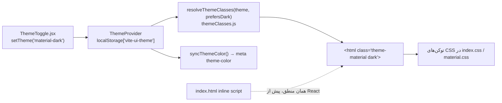

# ۰۹ — سیستمِ UI، تم، RTL و فارسی‌سازی

## هدف

بدانید رنگ را چطور انتخاب کنید (نه با پالتِ Tailwind)، تمِ جدید یا توکنِ جدید را کجا تعریف کنید، RTL از کجا می‌آید، و تاریخ/عدد/ورودیِ فارسی را با کدام تابع نشان دهید.

## فایل‌های کلیدی

| فایل | نقش |
| --- | --- |
| `src/index.css` | ترتیبِ لایه‌ها، `@import`ها، `@custom-variant`، `@theme inline`، توکن‌های `:root`، `.dark`، `.theme-accessible`، `.theme-rose`، `.theme-forest` |
| `src/shared/styles/themes/material.css`، `material-tokens.css`، `material-components.css` | تمِ Material (نقش‌های `--md-*` و بازنویسیِ کامپوننت‌ها) |
| `src/shared/components/theme/ThemeProvider.jsx`، `themeClasses.js`، `themeContext.js`، `ThemeToggle.jsx` | انتخاب و اعمالِ تم |
| `src/shared/lib/syncThemeColor.js` | `<meta name="theme-color">` از `--background` |
| `src/shared/lib/tone.js` | `TONES`، `toneSoft`، `toneRow`، `toneSolid`، `toneText` |
| `src/shared/components/status/`، `src/shared/components/feedback/` | `StatusBadge`، `StatusText`، `Notice`، `ProgressStat`، … |
| `src/shared/components/ui/direction.jsx` | `DirectionProvider` |
| `src/shared/lib/dateUtils.js`، `numberFormat.js`، `persianDigits.js`، `numberToPersianWords.js` | فارسی‌سازی |
| `src/shared/components/ui/persian-date-picker.jsx` | انتخابگرِ تاریخِ شمسی |
| `src/shared/lib/utils.js` | `cn(...)` (clsx + tailwind-merge) |
| `src/app/dev/StyleGuidePage.jsx` | راهنمای زنده در `/dev/ui` (فقط `pnpm dev`) |

## چطور کار می‌کند

### تم: از انتخاب تا کلاس



مقدارهای ممکن (منوی `ThemeToggle.jsx`): `light`، `dark`، `system`، `material-light`، `material-dark`، `theme-accessible`، `theme-rose`، `theme-forest`. `ThemeProvider` قبل از افزودن، همه‌ی `THEME_CLASSES` را از `<html>` برمی‌دارد. تمِ Material دو کلاس می‌گیرد (`theme-material` + `light|dark`) تا واریانتِ `dark:` و توکن‌های پایه هم کار کنند. پیش‌فرضِ واقعی `"dark"` است (`defaultTheme="dark"` در `src/app/providers/AppProviders.jsx`).

### توکن‌ها و لایه‌ها

- `src/index.css` با `@layer theme, base, components, utilities, material;` شروع می‌شود. لایه‌ی `material` بعد از `utilities` است تا بتواند کلاس‌های cvaِ کامپوننت‌ها را فقط در تمِ Material بازنویسی کند.
- `@custom-variant dark (&:is(.dark *))` و `@custom-variant material (&:where(.theme-material, .theme-material *))`.
- `@theme inline` متغیرها را به utilityهای Tailwind وصل می‌کند؛ فونت: `--font-sans: "Vazirmatn Variable", system-ui, sans-serif` (بسته‌ی `@fontsource-variable/vazirmatn` در همین فایل import می‌شود).
- هر تم همان مجموعه‌ی توکن را بازتعریف می‌کند: shadcn (`--background`، `--primary`، `--destructive`، …) به‌علاوه‌ی توکن‌های وضعیت (`--success`، `--warning`، `--caution`، `--info`، `--special`).
- در Material فقط نقش‌های `--md-*` رنگِ واقعی دارند و توکن‌های shadcn به آن‌ها اشاره می‌کنند. `material.css` عمداً بیرون از `@layer` است تا با specificityِ `html.theme-material` بر `:root`/`.dark` غلبه کند. toastها از `--toast-*` همین فایل رنگ می‌گیرند.

### رنگِ وضعیت: tone

هر جا یک **معنا** انتخاب کنید؛ ظاهر از توکنِ تمِ فعلی می‌آید:

| tone | معنا (از `tone.js`) |
| --- | --- |
| `neutral` | پیش‌نویس، غیرفعال |
| `primary` | برند، برجسته‌ی بی‌طرف |
| `info` | در جریان، اطلاع |
| `success` | کامل، موفق |
| `warning` | در انتظار، نیازمند اقدام |
| `caution` | ناقص، مسئله‌دار (قرنطینه) |
| `special` | گردش‌های خاص (مرجوعی، نسیه) |
| `danger` | لغو، رد، اسقاط، خطا |

نگاشتِ «وضعیت → tone» کنارِ labelها در enum است:

```js
// src/shared/domain/enums/saleStatus.js
export const SALE_STATUS_TONES = Object.freeze({
  [SaleStatusEnum.PROFORMA]: "neutral",
  [SaleStatusEnum.PROCESSING]: "info",
  [SaleStatusEnum.PARTIALLY_DELIVERED]: "caution",
  [SaleStatusEnum.DELIVERED]: "success",
  [SaleStatusEnum.CANCELLED]: "danger",
  // ...
});
// src/shared/components/status/SaleStatusBadge.jsx
<StatusBadge tone={SALE_STATUS_TONES[status]} ...>
```

کامپوننت‌ها: `StatusBadge` (`src/shared/components/status/StatusBadge.jsx`، با `toneSoft`)، `SaleStatusBadge`، `PurchaseStatusBadge`، `PaymentTypeBadge`، `StatusText`؛ باکسِ توضیح/هشدار `Notice` و پیشرفت `ProgressStat` در `src/shared/components/feedback/`. آیکنِ وضعیت‌ها در `src/shared/components/status/statusIcons.js`.

### RTL

- `index.html`: `<html lang="fa-IR" dir="rtl">`.
- `src/main.jsx`: `<DirectionProvider direction="rtl">` برای Radix (منو، popover، …).
- `components.json`: `rtl: true` تا shadcn کامپوننت‌ها را با کلاس‌های منطقی تولید کند.
- سایدبار: `<AppSidebar side="right" />` در `src/app/layouts/AppLayout.jsx`.
- toastها `direction: "rtl"` در `src/app/providers/ToastProvider.jsx`.
- کلاس‌های جهت: کدِ فعلی بیشتر کلاسِ فیزیکی (`ml-*`، `mr-*`) دارد تا منطقی (`ms-*`، `me-*`)؛ قراردادِ واحدی نیست (پایین). برای کدِ تازه کلاسِ منطقی امن‌تر است.

### فارسی‌سازیِ داده

| کار | تابع |
| --- | --- |
| تاریخِ ISO سرور → `۱۴۰۳/۰۵/۱۲` | `gregorianToPersian` (`src/shared/lib/dateUtils.js`) — بخشِ ساعت را می‌بُرد |
| امروز/الان برای فرستادن به سرور | `todayIso()`، `nowLocalIso()`، `toDateOnly()` (همان فایل) |
| ورودیِ تاریخ | `PersianDatePicker` (`src/shared/components/ui/persian-date-picker.jsx`) |
| عدد با جداکننده‌ی فارسی | `formatNumber` (`toLocaleString("fa-IR")`)، `formatRial`، `formatDigits` (`src/shared/lib/numberFormat.js`) |
| عدد به حروف | `numberToPersianWords`، `rialAmountInWords` (`src/shared/lib/numberToPersianWords.js`) |
| ارقامِ فارسی/عربیِ تایپ‌شده → لاتین | `normalizePersianDigits` (`src/shared/lib/persianDigits.js`) |
| ورودی‌های تخصصی | `price-input.jsx`، `mobile-number-input.jsx`، `national-id-input.jsx`، `bank-input.jsx`، `plate-input.jsx`، `city-selector.jsx` در `src/shared/components/ui/` |

**i18n وجود ندارد.** هیچ کتابخانه‌ی ترجمه‌ای نیست؛ همه‌ی متن‌ها فارسیِ مستقیم در JSX و enumها هستند (labelها در `src/shared/domain/enums/*`).

## قراردادها و نکته‌ها

- **رنگِ پالتِ Tailwind (`amber-50`، `green-700`، `oklch(...)`) برای معنا ننویسید**؛ tone یا توکن (`bg-success/12`). وضعیتِ فعلی: ۲۰ مورد در ۴ فایل — `src/shared/components/theme/ThemeToggle.jsx` (رنگِ آیکنِ هر تم، عمدی)، `src/shared/components/ui/plate-input.jsx`، `src/shared/components/feedback/Notice.jsx` (فقط در کامنت)، `src/features/accounting/activity/components/ActivityRankList.jsx`.
- کلاس‌ها در `tone.js` رشته‌ی کاملِ ثابت‌اند تا Tailwind پیدایشان کند؛ کلاس را با الحاقِ رشته نسازید (`bg-${tone}`).
- `dark:` برای رنگ لازم نیست؛ هر تم توکن‌هایش را دارد.
- `cn()` را برای ترکیبِ کلاس استفاده کنید تا کلاس‌های متضاد ادغام شوند.
- اسکریپتِ inlineِ `index.html` منطقِ `resolveThemeClasses` را تکرار می‌کند؛ تمِ جدید باید در هر دو اضافه شود.
- کامپوننت‌های `src/shared/components/ui/` تولیدِ shadcn هستند؛ بازنویسیِ ظاهرِ Material در `material-components.css` است نه در خودِ فایل‌ها.

## برای تغییرِ X، به Y بروید

| می‌خواهم… | کجا |
| --- | --- |
| تمِ تازه | بلوکِ `.theme-<name>` در `src/index.css` (همه‌ی توکن‌ها)، `THEME_CLASSES` و `resolveThemeClasses` در `themeClasses.js`، گزینه در `ThemeToggle.jsx`، اسکریپتِ `index.html` |
| یک رنگِ تمِ موجود | بلوکِ همان تم در `src/index.css` یا `--md-*` در `material.css` |
| معنای رنگیِ تازه (tone) | توکن در هر تم در `index.css` + `@theme inline` + هر چهار نقشه در `src/shared/lib/tone.js` |
| رنگِ یک وضعیت | `*_TONES` در `src/shared/domain/enums/<x>.js` |
| ظاهرِ یک کامپوننتِ پایه فقط در Material | `src/shared/styles/themes/material-components.css` |
| قالبِ تاریخ | `gregorianToPersian` در `src/shared/lib/dateUtils.js` |
| دیدنِ همه‌ی کامپوننت‌ها و toneها | `pnpm dev` → `/dev/ui` (`src/app/dev/StyleGuidePage.jsx`) |

## سؤال‌های باز / بدهی

- **`system` به تغییرِ تمِ سیستم‌عامل گوش نمی‌دهد:** `ThemeProvider` فقط هنگامِ تغییرِ `theme` یک بار `matchMedia` را می‌خواند و listener ندارد.
- `--font-mono: "Fira Code"` تعریف شده ولی فونت import یا بارگذاری نمی‌شود (جست‌وجوی `Fira` فقط همین خط را پیدا کرد).
- ۱۰۱ استفاده از کلاس‌های فیزیکیِ جهت (`ml-*`، `mr-*`، `pl-*`، `pr-*`، `left-*`، `right-*`) بیرون از `src/shared/components/ui/` در برابرِ ۱۶ استفاده از کلاس‌های منطقی (`ms-*`، `me-*`، …) در همان محدوده (grep). یعنی در عمل کلاس‌های فیزیکی رایج‌ترند. در RTLِ ثابت درست کار می‌کنند ولی قراردادِ واحدی نیست.
- `ActivityRankList.jsx` و `plate-input.jsx` رنگِ پالت دارند (فهرستِ بالا).
- `MATERIAL_THEMES` در `themeClasses.js` export شده ولی طبقِ knip بی‌استفاده است.
- منطقِ تم دو نسخه است (`index.html` و `themeClasses.js`).
