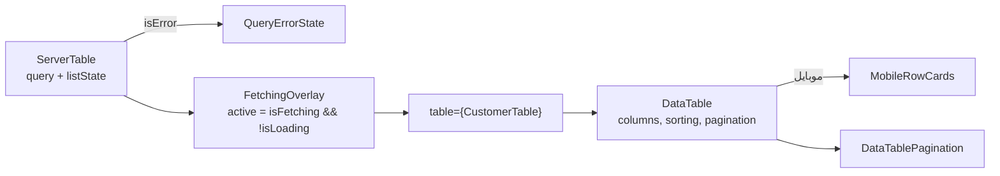

# ۱۰ — کاتالوگِ کامپوننت‌های مشترک

## هدف

قبل از ساختنِ کامپوننتِ تازه، اینجا ببینید آماده‌اش هست یا نه. همه زیرِ `src/shared/components/` هستند. ستونِ «#» تعدادِ فایل‌هایی است که آن را با مسیرِ `@/shared/components/...` import می‌کنند (grep، 2026-10-16). `داخلی` یعنی فقط فایل‌های هم‌پوشه با importِ نسبی آن را استفاده می‌کنند.

## فایل‌های کلیدی

- `src/shared/components/ui/` — پایه‌های shadcn/Radix (`button`، `dialog`، `select`، `sidebar`، `table`، …) و ورودی‌های فارسی (`persian-date-picker`، `price-input`، `mobile-number-input`، `national-id-input`، `bank-input`، `plate-input`، `city-selector`). تولیدِ CLI؛ فقط در صورتِ نیاز دست بخورند ([01](01-tech-stack-and-tooling.md)).
- راهنمای زنده: `pnpm dev` → `/dev/ui` (`src/app/dev/StyleGuidePage.jsx`، `src/app/dev/ComponentShowcase.jsx`).

## چطور کار می‌کند: یک صفحه‌ی لیستِ کامل از قطعاتِ مشترک

```jsx
// src/features/customers/pages/CustomersPage.jsx
<ListPageLayout
  title="مدیریت مشتریان"
  create={{ label: "مشتری جدید", to: ROUTES.CUSTOMERS_NEW }}
  actions={<DataTransferActions resource="customers" filters={filters} invalidateKey={customerKeys.all} />}
>
  <PartyListFilters useStore={useCustomerFilterStore} searchKey="fullName" searchPlaceholder="نام مشتری..." />
  <ServerTable query={query} listState={listState} table={CustomerTable} />
</ListPageLayout>
```



`ServerTable` (`src/shared/components/table/ServerTable.jsx`) کارِ تکراری را می‌کند: خطا → `QueryErrorState`، واکشیِ دوباره → `FetchingOverlay`، و تبدیلِ `{ items, total, page, totalPages }` و `listState` (از `createFilterStore`) به propsِ جدول. جدولِ هر فیچر فقط `DataTable` را با `columns` می‌پیچد (`src/features/customers/components/CustomerTable.jsx`).

**`table` و React Compiler:** نمونه‌ی `useReactTable` در همه‌ی رندرها همان شیء است. Compiler خودِ `DataTable` را memo نمی‌کند (هشدارِ `react-hooks/incompatible-library`)، ولی فرزندی که فقط `table` را prop می‌گیرد با همان `table` دوباره رندر نمی‌شود و `table.getState()` در آن کهنه می‌ماند. هر state‌ی که فرزند لازم دارد (مثلِ `sorting` برای `MobileRowCards`) را جدا prop بدهید.

## کاتالوگ

### `table/`

| کامپوننت | کِی | # |
| --- | --- | --- |
| `ServerTable` | لیستِ صفحه‌بندی‌شده‌ی سرور در صفحه‌ی لیست؛ `transform`، `singlePage` | ۱۷ |
| `DataTable` | پوسته‌ی جدول (مرتب‌سازیِ تک‌ستونی، `sortable`، `emptyState`، `rowClassName`، `getRowKey`)؛ در موبایل `MobileRowCards` | ۱۹ |
| `detailsColumn(getPath)` (`columns.jsx`) | ستونِ استانداردِ «جزئیات»؛ در موبایل کلِ کارت لینک می‌شود | ۹ |
| `DataTablePagination` | صفحه‌بندی بیرون از `DataTable` | ۴ |
| `PaymentProgress` | نوارِ «پرداخت‌شده از کل» در ردیف | ۲ |
| `RefreshButton` | «تازه‌سازی»ِ فهرستِ زنده در `actions`ِ `ListPageLayout` (صف‌های انبار و صندوق) | ۲ |
| `TableLoadingSkeleton` | اسکلتونِ جدول | ۲ |
| `MobileRowCards`، `SortIcon`، `DetailsLink` | داخلی | — |

### `layout/`

| کامپوننت | کِی | # |
| --- | --- | --- |
| `ListPageLayout` | پوسته‌ی هر صفحه‌ی لیست: `title`، `icon`، `description`، `create`، `actions` | ۱۱ |
| `MasterListPane` | ستونِ فهرست در صفحه‌های «فهرست/جزئیات» کنارِ هم (دسترسی‌ها، خودروها) | ۴ |
| `RedirectKeepingSearch` | در `routes.jsx`: نشانیِ قدیمی → تازه با همان query (صفحه‌ی جابه‌جاشده) | ۲ |
| `PageHeaderActions` | دکمه‌ی صفحه در هدرِ اپ کنارِ عنوان (پورتال به `headerStore.actionsSlot`)؛ مثلاً «تاریخچه» در صفحه‌های جزئیات ([08](08-client-state-zustand.md)) | ۲ |
| `AppSidebar`، `NavMain`، `NavSecondary`، `NavTools`، `NavUser`، `NavWorkspace`، `AppBreadcrumb`، `RouteLoadingOverlay` | فقط پوسته‌ی برنامه ([03](03-bootstrap-and-routing.md)) | ۱–۲ |

### `filters/`

| کامپوننت | کِی | # |
| --- | --- | --- |
| `FilterPanel` / `ResponsiveFilters` | پوسته‌ی فیلترها؛ موبایل: `primary`/`secondary` همیشه‌پیدا + پنلِ بازشونده با شمارِ فیلترِ فعال (`store`) | ۱۷ |
| `FilterSearchInput` | جست‌وجوی متنی | ۱۵ |
| `FilterSelect` | انتخابِ تکیِ کم‌گزینه | ۱۳ |
| `EntitySelect` | انتخابِ **یک** موجودیت با جست‌وجو (گزینه‌ی زیاد)؛ عمداً تک‌انتخابی چون endpointها یک شناسه می‌گیرند | ۱۲ |
| `DateRangeToolbar` | بازه‌ی تاریخ با میان‌برها (گزارش‌ها) | ۸ |
| `FilterDateInput`، `FilterMultiChoice`، `FilterSwitch` | تاریخ، چندگزینه، سوییچ | ۴–۶ |
| `filterUtils.js` | `normalizeFilterValue`، `toFilterOptions`، `getPartyName` | ۹ |

### `feedback/`

| کامپوننت | کِی | # |
| --- | --- | --- |
| `ConfirmDialog` | تأییدِ کارِ برگشت‌ناپذیر؛ تا پایانِ درخواست باز می‌ماند — فراخوان در `onSuccess` می‌بندد | ۱۶ |
| `QueryErrorState` | خطای لیست با «تلاش دوباره» (جای جدول) | ۱۵ |
| `DetailErrorState` | صفحه‌ی جزئیات: «پیدا نشد» (۴۰۴) را از «واکشی شکست خورد» جدا می‌کند | ۱۴ |
| `Notice` | باکسِ توضیح/هشدار با tone | ۱۴ |
| `UnsavedChangesDialog` | «تغییرات ذخیره نشده» با `blocker`ِ `useUnsavedChangesGuard` (یا کنترل‌شده با `open`) | ۶ |
| `FetchingOverlay` | پوششِ واکشیِ دوباره (نه بارِ اول) | ۹ |
| `ProgressStat` | پیشرفتِ شمارشی | ۴ |

### `status/`

| کامپوننت | کِی | # |
| --- | --- | --- |
| `StatusBadge` | هر وضعیت با `tone` ([09](09-ui-system-theming-rtl.md)) | ۲۵ |
| `SaleStatusBadge`، `PurchaseStatusBadge`، `PaymentTypeBadge` | وضعیتِ فروش/خرید/نوعِ پرداخت با tone و آیکن از enum | ۵ |
| `StatusText` | متنِ رنگی | ۲ |
| `statusIcons.js` | `SALE_STATUS_ICONS`، `PURCHASE_STATUS_ICONS` | داخلی |

`ReturnStatusBadge` در `returns/` است.

### `forms/`

| کامپوننت | کِی | # |
| --- | --- | --- |
| `FormField`، `FormSelectField` | فیلدِ react-hook-form با label و خطا | ۶، ۳ |
| `FormSectionCard` | کارتِ بخشِ فرم با هدرِ آیکون‌دار (مشتری، تامین‌کننده، …) | ۱۱ |
| `SectionCard` | کارتِ بخشِ صفحه‌ی سند (هدرِ ساده + `action`) | ۸ |
| `DocumentFormLayout` (`main`/`payments`/`aside`، و `below` تمام‌عرض) + `FormSection`، `OrderSummaryCard` | چیدمانِ دوستونیِ فرمِ خرید/فروش؛ کلِ صفحه یک `<form>`؛ prop‌ِ `payments` در موبایل بین «سند فاکتور» و کارتِ جمع و ثبت می‌نشیند | ۴ |
| `StatusChoice` | انتخابِ وضعیت به‌صورتِ دکمه | ۷ |
| `ProductThumb`، `QuantityStepper`، `AmountInWords` | تصویرِ کالا، +/− تعداد، مبلغ به حروف | ۵–۶ |
| `OrderInfoCard`، `OrderItemsReadOnly`، `OrderLogisticsSection`، `TransporterSection`، `PartySection` | بخش‌های سندِ خرید/فروش (`OrderInfoCard`: `showInvoiceDate`/`showDueDate` برای فروش، که تاریخِ فاکتور را سرور می‌گذارد و سررسید جزوِ پیش‌فاکتور است) | ۲–۴ |
| `ProductSearchPanel`، `PartyPickerCard`، `SelectedItemsCards`، `SelectedItemsTable`، `MixedPaymentList` | انتخابِ کالا/طرف‌حساب در فرمِ سند | ۱–۳ |
| `ScannedUnitCodes` | داخلی | — |

### `payments/`

| کامپوننت | کِی | # |
| --- | --- | --- |
| `PaymentsCard` | همه‌ی پرداخت‌های یک سند؛ جز کارتخوان، همه در پیش‌نویسِ `usePaymentDraft` تا «ثبت تغییرات». تخصیص‌های علی‌الحساب (`allocations`) فقط نمایش و جزوِ پرداخت‌شده | ۴ |
| `PaymentForm`، `PaymentRow`، `PaymentMethodEditor`، `useFormPosPayment`، `pos/PosPaymentPanel`، `pos/PosReadyForm`، `pos/PosResultViews` | داخلیِ `PaymentsCard` | — |
| `BankAccountSelect` | صندوق/حسابِ یک دریافت/پرداختِ نقدی یا انتقالی (`GetBankAccountOptions`)؛ «بدون حساب» = `null`؛ بی حسابِ تعریف‌شده چیزی رندر نمی‌کند | ۲ |

### `returns/` (مرجوعیِ خرید و فروش، [11](11-domain-layer.md))

قطعاتِ صفحه‌ی مرجوعی که هر دو فیچر استفاده می‌کنند (اغلب ۲ مصرف‌کننده = خرید + فروش): `ReturnSourcePicker`، `ReturnInfoSection`، `ReturnItemsSection`، `ReturnResolutionSection`، `ReturnDocumentSection`، `ReturnStatusBar`، `ReturnSubmitBar`، `ReturnTable`، `ReturnFilters`، `ReturnStatusBadge`، `RelatedReturnsCard`، `OrderInvoiceCard`، `ReceivingReportCard`/`ReceivingReportLines`، `GoodsRoundItemsSection`، `GoodsRoundPartySection`، `GoodsRoundSummaryCard`، `ObservationEditor`، `DeleteReturnAction`، `PreviousReturnBadge`/`FollowUpReturnAction` (`ReturnChain.jsx`)، `ReturnPageSkeleton`، `ReturnSourceError`. داخلی: `ClaimRow`، `ClaimResolutionCard`، `EffectBadge`، `GoodsItemsPicker`، `ResolutionComposer`، `ResolutionLineRow`، `ResolutionMoneySection`، `ReturnStatusReasonDialog`.

### بقیه

| پوشه | کامپوننت‌ها | کِی |
| --- | --- | --- |
| `charts/` | `ChartCard` (۱۲)، `GroupedBarChart`، `TrendChart`، `DonutChart`، `Sparkline`، `chartUtils.js` (۹)؛ داخلی: `ChartLegend`، `ChartTooltip`، `useChartSize` | نمودارهای SVGِ دست‌ساز (کتابخانه‌ی نمودار نیست)؛ داشبورد و حسابداری |
| `dataTransfer/` | `DataTransferActions` (۹)؛ داخلی: `ImportDialog`، `ImportResultView` | دکمه‌ی ورود/خروجیِ CSV/Excel در سرتیترِ لیست؛ مجاز بودن از سرور (`GetResources`) |
| `files/` | `RemoteImage` (۵)، `ImageUploadField` (۳)، `FileUploadList`، `ImageLightbox` | تصویر از سرور، آپلودِ تصویر/پیوست |
| `invoice/` | `InvoiceDocumentSection` (۵)، `useInvoiceAttachments`/`useDocumentAttachments` (۴)، `IssuedInvoiceNotice`، `InvoiceAttachmentsSaveButton` | خروجیِ فاکتور و پیوستِ سند؛ `InvoiceDocumentSection.localPrints` برای برگه‌های ساختِ صفحه (لیست قیمت‌ها) کنارِ سندها |
| `print/` | `BarcodeGraphic`، `QrCodeGraphic`، `LabelSheet`، `sheetPresets.js`، `usePrint` | چاپ برچسب و صفحه با مرورگر (`[data-print-root]`) |
| `barcode/` | `CameraScanButton` (۳)، `UnitBarcodeScanList` (۲)؛ داخلی: `CameraScanner`، `BarcodeScanField` | اسکنِ بارکد با دوربین |
| `map/` | `LocationPickerMap` (۱)؛ داخلی: `MapCanvas`، `MapSearchBar`، `nominatim.js` | انتخابِ مکان روی نقشه (Leaflet + Nominatim) |
| `products/` | `ProductPicker`، `DocumentItemsSection`، `useReturnedNewProduct` | انتخابِ کالا و برگشت از «کالای جدید» |
| `skeletons/` | `WarehouseFormSkeleton` (۴)، `OrderFormSkeleton` (۲) | اسکلتونِ فرم‌ها |
| `theme/` | `ThemeProvider`، `ThemeToggle`، `useTheme` | [09](09-ui-system-theming-rtl.md) |

## قراردادها و نکته‌ها

- **صفحه‌ی لیست:** `ListPageLayout` + فیلتر در `FilterPanel`/`ResponsiveFilters` + `ServerTable` با جدولی که `DataTable` را می‌پیچد. خطا و overlay را دستی نسازید.
- **صفحه‌ی جزئیات:** در خطا/۴۰۴ `DetailErrorState` با `onRetry={refetch}`.
- **حذف/لغو:** `ConfirmDialog`؛ در `onSuccess`ِ mutation ببندید، نه در `onConfirm`.
- **وضعیت:** `StatusBadge` با tone از enum؛ رنگِ پالت ننویسید.
- چند کامپوننت در `shared/components` از `@/features/...` import می‌کنند (`PartyPickerCard`، `ProductSearchPanel`، `ProductPicker`، `useReturnedNewProduct`، `layout/AppSidebar`، `NavUser`، `NavWorkspace`) — فایل ۰۲ و ۱۴.
- کامپوننتی که فقط یک فیچر مصرف می‌کند در همان فیچر بماند ([02](02-folder-structure.md)).

## برای تغییرِ X، به Y بروید

| می‌خواهم… | کجا |
| --- | --- |
| صفحه‌ی لیستِ تازه | الگو: `src/features/customers/pages/CustomersPage.jsx` + `src/features/customers/components/CustomerTable.jsx` |
| رفتارِ همه‌ی جدول‌ها (موبایل، صفحه‌بندی) | `src/shared/components/table/DataTable.jsx`، `MobileRowCards.jsx`، `DataTablePagination.jsx` |
| رفتارِ خطا/بارگذاریِ لیست‌ها | `src/shared/components/table/ServerTable.jsx` |
| فیلترِ تازه با ظاهرِ مشترک | `src/shared/components/filters/` (الگو: `PartyListFilters` در `src/features/partyAccount/components/PartyListFilters.jsx`) |
| ورود/خروجی برای یک لیست | `<DataTransferActions resource="…" filters={filters} invalidateKey={…Keys.all} />` در `actions`ِ `ListPageLayout` |
| دکمه در هدرِ صفحه‌ی جزئیات | `<PageHeaderActions>` (`src/shared/components/layout/PageHeaderActions.jsx`) |
| تاریخچه‌ی تغییراتِ یک سند/رکورد | `AuditHistoryButton` از `src/features/audit/components/AuditHistoryButton.jsx` ([12-features/audit](12-features/audit.md)) |
| کامپوننتِ پایه‌ی shadcn | CLIِ shadcn → `src/shared/components/ui/` |

## سؤال‌های باز / بدهی

- `src/shared/components/app-update/AppUpdateDialog.jsx` و `UpdateAvailableToast.jsx` بی‌استفاده‌اند (knip؛ PWA غیرفعال).
- `charts/chartUtils.js` یک `formatNumber` جدا از `src/shared/lib/numberFormat.js` export می‌کند؛ دو تابع با یک نام و رفتارِ کمی متفاوت (`maximumFractionDigits: 0` در نسخه‌ی نمودار؛ `Number(value) || 0` در نسخه‌ی lib).
- `DataTable` (۱۹) بیشتر از `ServerTable` (۱۷) مستقیم import می‌شود، چون جدول‌های فیچر آن را می‌پیچند؛ این عمدی است، نه تکرار.
