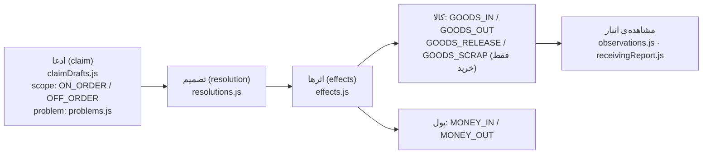

# ۱۱ — لایه‌ی دامنه (`domain/`)

## هدف

بدانید منطقِ کسب‌وکارِ خالص (بدونِ React) کجاست: enumها و برچسب و رنگشان، قواعدِ «این سند را می‌شود لغو کرد؟»، محاسبه‌ی قلمِ فاکتور، تقسیمِ پرداخت، و مدلِ مرجوعی. و enum یا قاعده‌ی تازه را کجا بگذارید.

## فایل‌های کلیدی

| مسیر | محتوا |
| --- | --- |
| `src/shared/domain/enums/` | ۱۶ فایل enum (`purchaseStatus.js`، `saleStatus.js`، `paymentType.js`، `unitStatus.js`، `saleInstallment.js`، `documentKind.js`، …) |
| `src/shared/domain/returns/` | مدلِ مرجوعیِ مشترکِ خرید/فروش (۱۲ فایل) |
| `src/shared/domain/payments/` | `paymentRows.js`، `paymentSplit.js` |
| `src/shared/domain/invoice/` | `lineMath.js`، `lineFromProduct.js` |
| `src/shared/domain/pos/posSession.js` | ماشینِ حالتِ کارتخوان (`posSessionReducer`) |
| `src/shared/domain/barcode/` | `productCode.js`، `barcodeConfig.js`، `frameReader.js` |
| `src/features/**/domain/` | قواعدِ مخصوصِ یک فیچر (`saleRules.js`، `purchaseRules.js`، `installmentPlan.js`، `widgetRegistry.js`، …) |
| `../Backend-Net/docs/api-guide.fa.md` بخش ۱۵ | قراردادِ فعلیِ enumها با بکند |

هیچ فایلی در `domain/` از `react` import نمی‌کند (grep). تنها وابستگیِ UI: `src/shared/domain/returns/scopes.js` از `toneSoft` (`src/shared/lib/tone.js`) استفاده می‌کند.

## چطور کار می‌کند

### ۱. شکلِ یک enum

هر فایلِ `src/shared/domain/enums/<x>.js` یک شیءِ `Object.freeze`ِ عددی با **همان اعدادِ بکند** دارد (روی سیم همیشه عدد است)، کنارش برچسبِ فارسی، tone، و کمک‌تابع‌های کوچک:

```js
// src/shared/domain/enums/purchaseStatus.js
export const PurchaseStatusEnum = Object.freeze({
  PROFORMA: 0, PENDING: 1, SHIPPED: 2, PARTIALLY_RECEIVED: 3, RECEIVED: 4, CANCELLED: 5,
});
export const PURCHASE_STATUS_LABELS = Object.freeze({ [PurchaseStatusEnum.PROFORMA]: "پیش‌فاکتور", /* ... */ });
export const PURCHASE_STATUS_TONES  = Object.freeze({ [PurchaseStatusEnum.PROFORMA]: "neutral",   /* ... */ });
export function isPurchaseProforma(status) { /* ... */ }
```

نام‌گذاری: `<Name>Enum`، `<NAME>_LABELS`، `<NAME>_TONES`. نگاشتِ اعداد لازم نیست؛ کامنتِ هر فایل می‌گوید با کدام enumِ بکند هم‌خوان است (مثلاً «بکند از ۲۰۲۶-۰۹-۰۲ دقیقاً همین شماره‌گذاری را دارد»).

`src/shared/domain/enums/documentKind.js` (`DocumentKindEnum`، `DOCUMENT_KIND_LABELS`، `documentRouteOf(kind, id)`) سندی است که یک ردیف به آن تعلق دارد؛ در دانه‌ها (`warehouse/units`) و تاریخچه (`audit`) مشترک است.

enumهای فقط-فرانت (بدونِ معادلِ بکند) صریحاً کامنت دارند: `RETURN_SIDES` در `src/shared/domain/returns/sides.js`، `CLAIM_SCOPES` و `OFF_SCOPE_KINDS` در `src/shared/domain/returns/scopes.js`.

### ۲. قواعدِ فیچر

قاعده‌هایی که UI با آن تصمیم می‌گیرد چه دکمه‌ای فعال باشد، کنارِ فیچر:

- `src/features/sales/orders/domain/saleRules.js` — `canCancelSale`، `saleStatusOptions`، `RETURNABLE_SALE_STATUSES`، `missingSaleInvoiceFields`، `saleFormProblem`، `hasAnythingShipped`، `scannedBarcodesOf`
- `src/features/purchases/orders/domain/purchaseRules.js` — `canCancelPurchase`، `purchaseStatusTargets`، `canClosePurchaseItem`، `canReopenPurchaseItem`، `stillOwedOf`
- `src/features/sales/installments/domain/installmentPlan.js` — `previewInstallmentPlan`، `planDraftErrors`، `EMPTY_PLAN_DRAFT`، `overdueOf`، `installmentPayableToday`، `grossPenaltyOf`، `penaltyWaiveErrors`
- `src/features/warehouse/receiving/domain/receivingVocabulary.js`، `src/features/warehouse/shipping/domain/shippingVocabulary.js` — کدام وضعیت‌ها در صفِ دریافت/ارسال‌اند
- `src/features/warehouse/units/domain/unitVocabulary.js`، `labelTemplate.js` — بخش‌بندیِ دانه‌ها و قالبِ برچسب
- `src/features/dashboard/domain/widgetRegistry.js` — `WIDGETS`، `defaultLayout`، `resolveLayout` (معماریِ ویجتِ داشبورد؛ [12-features](12-features/README.md))
- `src/features/audit/domain/auditVocabulary.js` — برچسبِ فارسیِ نوعِ سطر و نامِ ستون، `formatAuditValue` (enum/تاریخ/شناسه)، `changeTargetOf` (پیوند به سند یا رکورد)؛ `auditEnums.js` — `AuditOperationEnum`، گروهِ عملیات

این‌ها پیش‌نمایش/UX هستند؛ سرور قاعده را دوباره اجرا می‌کند.

### ۳. محاسبه‌ی فاکتور

`invoiceLineAmounts(item)` و `invoiceTotals` در `src/shared/domain/invoice/lineMath.js` همان قاعده‌ی `InvoiceLineMath`ِ سرور را برای **پیش‌نمایش** تکرار می‌کنند: `gross = quantity × unitPrice`، تخفیف و مالیات **برای هر قلم جدا** گرد می‌شوند، کالای معاف (`TaxCategoryEnum.EXEMPT`) مالیات ندارد. بعد از ذخیره همیشه عددِ سرور نمایش داده می‌شود (`savedInvoiceTotals`). `taxKnown` می‌گوید نرخِ مالیات واقعاً معلوم بود یا صفر فرض شد (لیستِ کالا نرخ را نمی‌دهد).

### ۴. پرداخت

- `src/shared/domain/payments/paymentSplit.js` — فرمِ «ثبت پرداخت»: `{ method, rows }`؛ `amount: null` یعنی «باقیمانده». `newPaymentRow`، `addMixedRow`، `switchMethod`، `resolvedRows`، `rowsTotal`.
- `src/shared/domain/payments/paymentRows.js` — پیش‌نویسِ پرداخت‌های سند (`EMPTY_PAYMENT_DRAFT`) و تبدیل به payload (`toPaymentPayload`، `toApiPaymentRows`). مصرف: `usePaymentDraft` (`src/shared/hooks/usePaymentDraft.js`)، `PaymentsCard`، `runDocumentChanges`.
- جهتِ هر سند: `SALE_PAYMENT_SIDE` (`src/features/sales/orders/domain/salePayments.js`) و `PURCHASE_PAYMENT_SIDE` (`src/features/purchases/orders/domain/purchasePayments.js`).
- کارتخوان: `posSessionReducer` و `PosStatus` در `src/shared/domain/pos/posSession.js`؛ `isPosBusy`، `holdsMoney`، `canStartPos`.

### ۵. مرجوعی (`src/shared/domain/returns/`)

یک مدل برای هر دو سمت؛ فرقِ خرید و فروش تقریباً فقط برچسب است (`SIDE_CONFIG` در `sides.js`) به‌علاوه‌ی قرنطینه که فقط در خرید است.



| فایل | نقش |
| --- | --- |
| `effects.js` | `EFFECT_DIRECTIONS` (هم‌عددِ `ReturnEffectDirectionEnum`ِ بکند؛ نسبت به «ما»، نه طرف‌حساب)، `EFFECT_STATUSES`، `createEffect`، `summarizeEffects` |
| `claimDrafts.js` | ساخت/ویرایشِ ادعاها در فرم، `claimsPayloadOf` |
| `carryOverClaims.js` | `carryOverLineClaims`، `clampClaimsToCaps` — سقفِ ادعا بر اساسِ مقدارِ جابه‌جاشده و مرجوعی‌های دیگر |
| `resolutions.js` | `MONEY_DIRECTIONS`، ترکیبِ تصمیم، `suggestedMoneyAmount` |
| `claimsApi.js` | تبدیل از/به سرور: `toApiClaim`، `fromApiPurchaseReturn`، `fromApiSaleReturn`؛ در dev `verifyReturnEnums` |
| `apiEnums.js` | `verifyReturnEnums(doc)` — هر مقدارِ enumِ ناشناخته از سرور را با مسیرِ فیلد در کنسول گزارش می‌کند (فقط dev، چیزی را تغییر نمی‌دهد) |
| `statuses.js`، `problems.js`، `observations.js`، `scopes.js`، `sides.js`، `receivingReport.js` | واژگان و گزارشِ دریافت |

واژگانِ مخصوصِ هر سمت در فیچر: `src/features/sales/returns/domain/salesReturnVocabulary.js`، `src/features/purchases/returns/domain/purchaseReturnVocabulary.js`. mutationهای مشترک: `src/shared/services/returns/createReturnMutations.js`.

مراجعِ بکند: `../Backend-Net/docs/return-frontend-migration.fa.md`، `return-scenarios-guide.fa.md`، `purchase-return-guide.fa.md`.

## قراردادها و نکته‌ها

- **روی سیم عدد، در UI برچسب.** مقایسه با `XEnum.MEMBER`، نه با عدد یا رشته‌ی خام.
- enum وقتی در `shared/domain/enums/` است که بیش از یک فیچر لازمش دارد یا مستقیم از قراردادِ بکند است؛ enumِ داخلیِ یک فیچر در `domain/`ِ همان فیچر (مثل `AccountingPartyTypeEnum` در `src/features/accounting/domain/accountingEnums.js`، `UnitActionEnum` در `unitVocabulary.js`).
- اگر سرور عضوِ تازه‌ای اضافه کرد، برچسب و tone را هم اضافه کنید؛ وگرنه badge خالی می‌ماند. برای مرجوعی، `verifyReturnEnums` در dev هشدار می‌دهد؛ برای بقیه‌ی enumها چنین وارسی‌ای نیست.
- `../Backend-Net/docs/frontend-enum-contract.fa.md` طبقِ هشدارِ بالای خودش سندی تاریخی است؛ مرجعِ فعلی بخش ۱۵ِ `api-guide.fa.md` است.
- `domain/` بدونِ React بماند تا قابلِ تست و استفاده در هوک و کامپوننت باشد.

## برای تغییرِ X، به Y بروید

| می‌خواهم… | کجا |
| --- | --- |
| وضعیت/enumِ تازه از بکند | `src/shared/domain/enums/<x>.js` با `Enum` + `_LABELS` + `_TONES`؛ الگو: `purchaseStatus.js` |
| رنگ یا برچسبِ یک وضعیت | `*_TONES` / `*_LABELS` همان فایل |
| شرطِ فعال‌بودنِ دکمه‌ی لغو/صدور | `src/features/sales/orders/domain/saleRules.js` یا `src/features/purchases/orders/domain/purchaseRules.js` |
| محاسبه‌ی پیش‌نمایشِ فاکتور | `src/shared/domain/invoice/lineMath.js` (با قاعده‌ی سرور هم‌خوان نگه دارید) |
| روشِ پرداختِ تازه | `ROW_PAYMENT_TYPES` در `paymentSplit.js` + `PaymentTypeEnum` در `src/shared/domain/enums/paymentType.js` |
| رفتار/اثرِ مرجوعی | `src/shared/domain/returns/` (هر دو سمت را با هم عوض می‌کند)؛ برچسبِ یک سمت در `sides.js` |
| ویجتِ تازه‌ی داشبورد | `src/features/dashboard/domain/widgetRegistry.js` |

## سؤال‌های باز / بدهی

- `src/features/purchases/orders/domain/purchaseRules.js` `MANUAL_PurchaseStatusEnum` export می‌کند که در واقع آرایه‌ی وضعیت‌هاست (`PROFORMA`، `PENDING`، `SHIPPED`) نه enum؛ نامش با قراردادِ `<NAME>_STATUSES` (مثل `RETURNABLE_PURCHASE_STATUSES` در همان فایل) نمی‌خواند.
- وارسیِ enumِ ناشناخته فقط برای مرجوعی هست (`verifyReturnEnums`)؛ برای وضعیتِ خرید/فروش/دانه نیست.
- `lineMath.js` قاعده‌ی سرور را تکرار می‌کند؛ هیچ تستی هم‌خوانی‌شان را تضمین نمی‌کند.
- `scopes.js` در لایه‌ی دامنه به `tone.js` (UI) وابسته است.
