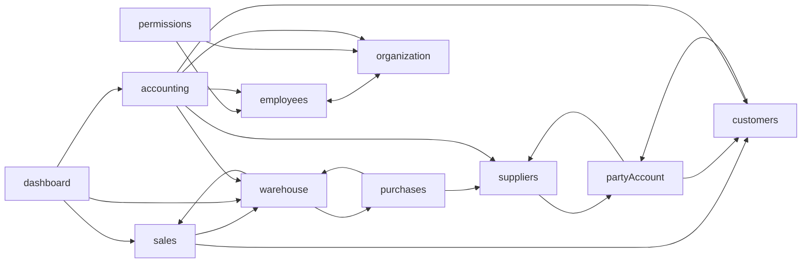

# ۱۲ — فیچرها (ماژول‌های کسب‌وکار)

هر فایل این پوشه یک ماژول را توضیح می‌دهد: مسیرها، صفحه‌ها، endpointها، state، جریان‌های اصلی، importهای بیرونی، و نکته/بدهی. برای الگوی عمومیِ هر لایه به فایل‌های ۰۳ تا ۱۱ رجوع کنید؛ اینجا فقط چیزی است که مخصوصِ همان ماژول است.

## جدولِ فهرست

| ماژول | پیشوندِ مسیر | صفحه‌های اصلی | سرویس‌ها | storeها | endpointهای بکند |
| --- | --- | --- | --- | --- | --- |
| [sales](sales.md) | `/sales` | `SalePage`، `SaleNewPage`، `SaleDetailPage` (`SaleForm` / `SaleIssuedView`)، `InstallmentsPage`، `SalesReturns*Page` | `src/features/sales/{orders,returns,installments}/services/` | `useSaleFormStore`، `useSaleFilterStore`، `useSalesReturnFormStore`، `useSalesReturnFilterStore`، `useInstallmentFilterStore` | `/Sale/*`، `/SaleReturn/*`، `/SaleInstallment/*` |
| [purchases](purchases.md) | `/purchases` | `PurchasesPage`، `PurchasesNewPage`، `PurchaseDetailPage` (`PurchaseForm` / `PurchaseIssuedView`)، `PurchaseReturn*Page` | `src/features/purchases/{orders,returns}/services/` | `usePurchaseFormStore`، `usePurchaseFilterStore`، `usePurchaseReturnFormStore`، `usePurchaseReturnFilterStore` | `/Purchase/*`، `/PurchaseReturn/*` |
| [warehouse](warehouse.md) | `/warehouse` | `ProductsPage`، `ProductNewPage`، `ProductDetailPage`، `CategoriesPage`، `VehiclesPage`، `UnitsPage`، `Receiving*Page`، `Shipping*Page`، `SupplierReturnDetailPage` | `src/features/warehouse/{products,categories,units,vehicles,receiving,shipping}/services/` | `useProductFilterStore`، `useProductUnitFilterStore`، `useLabelTemplateStore`، `useReceivingFormStore`، `useShippingFormStore`، … | `/Product/*`، `/ProductCategory/*`، `/Vehicle/*`، `/Shipment/*` (+ خواندن از `/Purchase`، `/Sale`، `/PurchaseReturn`، `/SaleReturn`) |
| [parties](parties.md) (customers، suppliers، partyAccount) | `/customers`، `/suppliers` | `CustomersPage`، `CustomerNewPage`، `CustomerDetailPage`، `Supplier*Page` | `src/features/{customers,suppliers,partyAccount}/services/` | `useCustomerFilterStore`، `useSupplierFilterStore` (از `createPartyFilterStore`) | `/Customer/*`، `/Supplier/*`، `/PartyAccount/GetPartyStatement` |
| [employees-organization](employees-organization.md) | `/employees`، `/organization` | `EmployeesPage`، `EmployeeNewPage`، `EmployeeDetailPage`، `Departments*`، `Teams*` | `src/features/employees/services/`، `src/features/organization/{departments,teams}/services/` | `useEmployeeFilterStore`، `useDepartmentFilterStore`، `useTeamFilterStore`؛ `useFormDraftStore` | `/User/*`، `/Department/*`، `/Team/*`، `/Account/LogoutUserById` |
| [permissions](permissions.md) | `/access` | `UserAccessPage`، `DepartmentTemplatesPage` | `src/features/permissions/services/` | — (`usePermissionDraft`) | `/Permission/*` |
| [dashboard](dashboard.md) | `/`، `/dashboard` | `DashboardPage` (ویجتی) | `src/features/dashboard/services/` | `useDashboardLayoutStore` (persist)، `useDashboardFilterStore` | `/Report/GetSaleReport`، `GetPurchaseReport`، `GetScopePerformance` + شمارشِ لیست‌ها |
| [accounting](accounting.md) | `/accounting` (+ ریدایرکتِ `/reports/*`) | `AccountingDashboardPage`، `PartyBalancesPage`، `PartyLedgerPage`، `InvoiceJournalPage`، … ، `*ActivityPage` | `src/features/accounting/services/`، `src/features/accounting/activity/services/` | `accountingFilterStores.js`، `activityFilterStore.js` | `/Accounting/*`، `/Report/*` |
| [auth](auth.md) | `/auth` | `LoginPage` | `src/features/auth/services/` | `useAuthStore` (persist) | `/Account/Login`، `Logout`، `RefreshToken`؛ `/User/GetUserInfo`؛ `/Permission/GetMyPermissions` |
| [placeholders](placeholders.md) (invoice، transactions، settings، reports) | `/invoice`، `/transactions`، `/settings` | placeholderهای ۶خطی | — | — | — |

پیشوندِ `/access` از `ROUTES.ACCESS` در `src/shared/constants/routes.js` است.

## نقشه‌ی وابستگیِ فیچرها

همه‌ی فیچرها به `auth` وابسته‌اند (رسم نشده). شمارشِ دقیقِ importها در [02-folder-structure.md](../02-folder-structure.md). در سطحِ فایل حلقه‌ای وجود ندارد ([14](../14-dependency-graph-and-health.md)).
