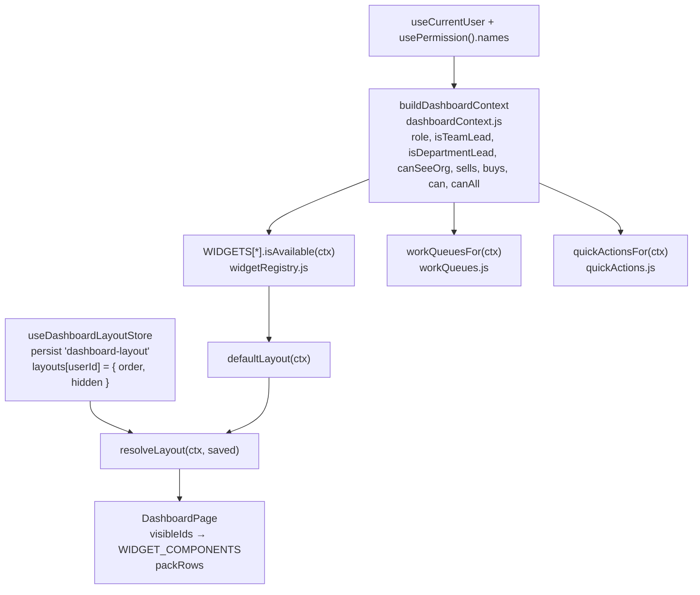

# dashboard — داشبوردِ ویجتی

## مسیرها

`ROUTES.DASHBOARD` = `/dashboard` و مسیرِ `index: true` (یعنی `/`) هر دو → `src/features/dashboard/pages/DashboardPage.jsx` (`src/features/dashboard/routes.jsx`). **بدونِ مجوز**؛ هر ویجت خودش در دسترس بودن را تعیین می‌کند.

## سرویس‌ها

`src/features/dashboard/services/api-v1.js` (همه GET):
- `fetchSaleReport` → `/Report/GetSaleReport`، `fetchPurchaseReport` → `/Report/GetPurchaseReport`، `fetchScopePerformance(scope, params)` → `/Report/GetScopePerformance`
- `fetchQueueCount(source, status, params)` → یکی از `QUEUE_ENDPOINTS` (`/Sale/GetSaleList`، `/Purchase/GetPurchaseList`، `/SaleReturn/GetSaleReturnList`، `/PurchaseReturn/GetPurchaseReturnList`، `/SaleInstallment/GetSaleInstallmentList`) با `page=1, take=1` — فقط برای `total`.

هوک‌ها (`queries.js`): `useDashboardReportsQuery`، `useScopePerformanceQuery` (روی ۴۰۳/۴۰۴ retry نمی‌کند؛ ۴۰۴ → `isUnavailable`)، `useQueueCountsQuery`. کلیدها در `src/features/dashboard/services/queryKeys.js`: `reportKeys` (`["reports"]`) و `dashboardKeys` (`["dashboard"]`).

## معماریِ ویجت

1. **context** — `useDashboardContext` (`src/features/dashboard/hooks/useDashboardContext.js`) → `buildDashboardContext`: `role` (پیش‌فرض `OrgRoleEnum.MEMBER`)، `isTeamLead` (سرپرست/جانشینِ تیم **و** `teamId != null`)، `isDepartmentLead`، `canSeeOrg` (`ReportView`)، `sells` (`SaleCreate` یا `SaleInPerson`)، `buys` (`PurchaseCreate`)، `can` (any-of)، `canAll` (all-of).
2. **ویجت‌ها** — هر عضوِ `WIDGETS` در `src/features/dashboard/domain/widgetRegistry.js`: `isAvailable(ctx)`، `span` (`full`/`wide`/`narrow`)، `periodic`، `locked`. `welcome` همیشه و قفل؛ `workQueues`/`quickActions` اگر فهرستشان خالی نباشد؛ `myPerformance` با `sells || buys`؛ ویجت‌های تیم/واحد برای سرپرست‌ها؛ ویجت‌های `org*` و `topSellers` با `canSeeOrg`.
3. **صف‌های کار** — `WORK_QUEUES` (دریافت، ارسال، پیش‌فاکتورِ فروش، خریدِ باز، اقساطِ سررسیدگذشته، مرجوعی‌ها)؛ هر صف `parts` دارد (یکی برای هر وضعیت) و `useQueueCountsQuery` برای هر part یک درخواستِ `take=1` می‌زند و `total`ها را جمع می‌کند. نیازمندِ **همه‌ی** مجوزهای صف (`canAll`).
4. **اقدام‌های سریع** — ۱۲ عضوِ `QUICK_ACTIONS`؛ `permission` هر کدام همان `handle.permission`ِ مسیرِ مقصد است.
5. **چیدمان** — `defaultLayout` ترتیبِ ثابت را فیلتر می‌کند (`orgPeriodTable` پیش‌فرض پنهان). `resolveLayout(ctx, saved)` ویجت‌های دیگر-دردسترس‌نبوده را حذف و ویجت‌های تازه را کنارِ نزدیک‌ترین همسایه در ترتیبِ پیش‌فرض اضافه می‌کند؛ ویجتِ قفل هیچ‌وقت پنهان نمی‌شود.
6. **ذخیره** — `useDashboardLayout` (`src/features/dashboard/hooks/useDashboardLayout.js`) با کلیدِ `context.user.id`؛ `toggle`/`move` فوراً ذخیره، `reset` پاک می‌کند. persist در `src/features/dashboard/store/dashboardLayoutStore.js` (`version: 1`). بعد از خروج عمداً می‌ماند (ترجیحِ دستگاه).
7. **رندر** — `DashboardPage` با `WIDGET_COMPONENTS` از `src/features/dashboard/components/widgets/index.jsx`؛ نوارِ بازه‌ی زمانی (`useDashboardFilterStore`) فقط وقتی دیده می‌شود که ویجتی `periodic` نمایان باشد. ویجت‌های سازمانی `useOrgReport` (`src/features/dashboard/hooks/useOrgReport.js`) را به اشتراک دارند.

محاسبه‌ها در `src/features/dashboard/domain/dashboardMetrics.js` (`buildKpis`، `buildPeriodSeries`، …) و `scopeMetrics.js`.

## importهای بیرونی

`auth` (`satisfies`، `usePermission`، `useCurrentUser`)؛ `sales/installments/domain/installmentViews`، `warehouse/receiving/domain/receivingVocabulary`، `warehouse/shipping/domain/shippingVocabulary` (در `workQueues.js`)؛ `accounting/activity/services/queries` (در `TopSellersWidget.jsx`).

## نکته‌ها و بدهی

- `isTeamLead` به `teamId` نیاز دارد ولی `isDepartmentLead` به `departmentId` نه (`dashboardContext.js`).
- `src/features/sales/installments/services/mutations.js` کلیدِ صف را دستی می‌سازد (`[...dashboardKeys.all, "queue", "saleInstallment"]`) — فایل [07](../07-server-state-react-query.md).
- هر صف = چند درخواستِ `take=1` (یکی برای هر part): دریافت ۲، ارسال ۲، پیش‌فاکتورِ فروش ۱، خریدِ باز ۲، اقساط ۱، هر مرجوعی ۲ — حداکثر **۱۲ درخواستِ هم‌زمان** برای کاربری با همه‌ی مجوزها (`src/features/dashboard/domain/workQueues.js`). یک endpointِ شمارشِ تجمیعی در بکند این را یکی می‌کند.
