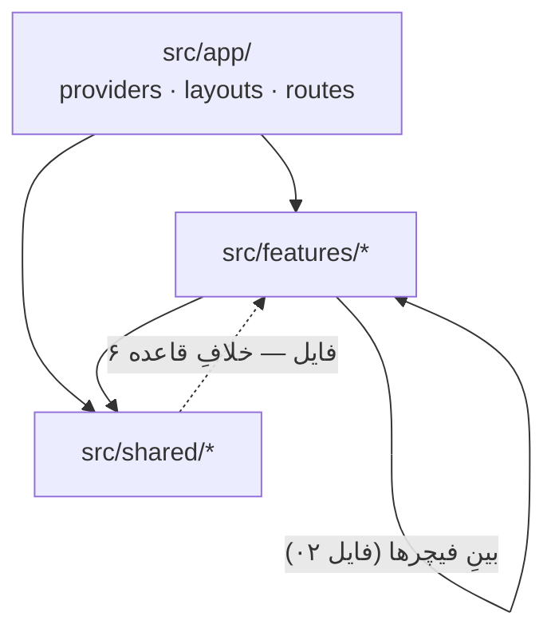

# ۱۴ — گرافِ وابستگی، کدِ مرده و بدهی‌های شناخته‌شده

## هدف

بدانید سلامتِ ساختاری را چطور بسنجید (حلقه، کدِ مرده، مرزِ لایه‌ها) و فهرستِ کاملِ بدهی‌هایی که در اسنادِ ۰۱ تا ۱۳ پیدا شد، هر کدام با پیشنهادِ رفع. **هیچ‌کدام از این‌ها در این مستندسازی رفع نشده‌اند.**

## ابزارها و نحوه‌ی اجرا

### madge (گرافِ وابستگی و حلقه)

madge بدونِ تنظیم aliasِ `@/` را نمی‌شناسد: اجرای سادهِ `npx madge --circular src` (و حتی با `--ts-config jsconfig.json`) ۳۵۵ import را رد می‌کند و «حلقه ندارد» را **به‌اشتباه** گزارش می‌دهد. با یک پیکربندیِ webpackِ موقت:

```bash
echo "module.exports={resolve:{alias:{'@':process.cwd()+'/src'},extensions:['.js','.jsx']}}" > /tmp/madge-alias.cjs
```

```bash
npx madge --circular --extensions js,jsx --webpack-config /tmp/madge-alias.cjs src
```

نتیجه (2026-10-17، بعد از فیچرِ `audit`): **۷۴۴ فایل، هیچ حلقه‌ای نیست.** ۱۴ هشدارِ باقی‌مانده importهای CSS هستند. graphviz نصب نیست؛ برای تصویر از `--json` و نمودارهای Mermaidِ همین اسناد استفاده کنید.

پرمصرف‌ترین ماژول‌ها (fan-in، تعدادِ فایل‌های واردکننده):

| # | فایل |
| --- | --- |
| ۱۳۹ | `src/shared/components/ui/button.jsx` |
| ۱۰۸ | `src/shared/lib/numberFormat.js` |
| ۱۰۵ | `src/shared/constants/routes.js` |
| ۹۸ | `src/shared/lib/utils.js` |
| ۴۶ | `src/shared/services/api/contract.js` |
| ۴۰ | `src/shared/lib/dateUtils.js` |
| ۳۳ | `src/shared/lib/errorMessage.js` |
| ۳۰ | `src/shared/hooks/usePageHeader.js` |
| ۲۹ | `src/features/auth/hooks/usePermission.js` |

تغییرِ امضای این‌ها اثرِ گسترده دارد. بیشترین fan-out: `src/features/sales/orders/pages/SaleForm.jsx` (۳۵)، `SaleIssuedView.jsx` (۲۸)، `src/features/purchases/returns/pages/PurchaseReturnNewPage.jsx` (۲۶)، `src/features/purchases/orders/pages/PurchaseForm.jsx` (۲۵).



### knip (کدِ مرده)

```bash
pnpm knip
```

نتیجه (2026-10-25، بعد از پاک‌سازیِ کدِ مرده):
- هیچ فایل، export یا وابستگیِ بی‌استفاده‌ای نیست.

knip فایل‌ها و exportهایی را که هیچ import ندارند پیدا می‌کند، نه صفحه‌ی placeholderی که در `routes.jsx` ثبت شده یا کلیدی از `ROUTES` که فقط در breadcrumb است؛ این‌ها را دستی بسنجید.

### بقیه

- `pnpm lint` — تنها بررسیِ ایستا؛ type-check نیست.
- `pnpm test` — Vitest روی منطقِ خالص (۱۴۰ تست، ۱۸ فایل، 2026-10-28): `src/shared/lib/` (عدد به حروف، رقم، موبایل، کدِ ملی، قاعده‌های فرم، تاریخ، پیامِ خطا)، پول (`invoice/lineMath`، `payments/paymentSplit`، `paymentRows`، اقساط، علی‌الحساب، حسابِ بانکی)، مرجوعی (`resolutions`، `claimDrafts`، `receivingReport`) و `tools/dev-inspector/sourceIndex`. پوششِ کلِ منطقِ خالص حدودِ ۴۵٪؛ داشبورد، واژه‌نامه‌ها و `labelTemplate` هنوز تست ندارند.
- `node scripts/check-docs-paths.mjs` — همه‌ی مسیرهای ذکرشده در `docs/architecture/` باید وجود داشته باشند.

## Known debt

ستونِ «شدت»: **باگ** (رفتارِ نادرستِ قابلِ مشاهده)، **ریسک** (ممکن است باگ شود)، **تمیزی** (سبک/ساختار). ترتیب: اول باگ‌ها.

### باگ‌ها (۰ باز)

باگ‌های B1 تا B8 در ۲۰۲۶-۱۰-۱۶ رفع شدند:

| # | مورد | رفع |
| --- | --- | --- |
| B1 | فیلترِ خودرو در لیستِ کالا به سرور نمی‌رسید | `"vehicleId"` در `instant`ِ `useProductListFilters` (`src/features/warehouse/products/services/queries.js`) |
| B2 | هر خطای رندر/loader فقط متنِ «NotFoundPage» نشان می‌داد | `src/app/layouts/NotFoundPage.jsx` صفحه‌ی ۴۰۴ِ واقعی است؛ `errorElement`ها `src/app/layouts/RouteErrorPage.jsx` (با `useRouteError`) در `src/app/routes/routers.jsx` |
| B3 | در خطای دریافتِ مجوزها منو خالی بود ولی صفحه‌ها باز | `AppSidebar` (`src/app/layouts/AppSidebar.jsx`) در `isError` منو را بی‌فیلتر نشان می‌دهد |
| B4 | تمِ `system` با تغییرِ تمِ سیستم‌عامل عوض نمی‌شد | listenerِ `change`ِ `matchMedia` در `src/shared/components/theme/ThemeProvider.jsx` وقتی `theme === "system"` |
| B5 | breadcrumbِ صفحه‌ی خودروها فقط «انبار» بود | `ROUTES.WAREHOUSE_VEHICLES` در `ROUTE_TITLES` و `DETAIL_TITLES`ِ `src/app/layouts/AppBreadcrumb.jsx` |
| B6 | `EmployeeNewPage` بعد از ساخت `returnTo` را نادیده می‌گرفت | `useReturnTo(ROUTES.EMPLOYEES).goBack` در `src/features/employees/pages/EmployeeNewPage.jsx` |
| B7 | ساختِ کالا با موجودیِ اولیه کشِ دانه‌ها را کهنه می‌گذاشت | `productUnitKeys.all` در `onSuccess`ِ `useCreateProductMutation` (`src/features/warehouse/products/services/mutations.js`) |
| B8 | انتخابِ مرتب‌سازی در موبایل همیشه روی «پیش‌فرض» می‌ماند | `sorting` جدا از `table` به `MobileRowCards` می‌رسد (`src/shared/components/table/DataTable.jsx`)؛ نکته‌ی React Compiler در [10](10-shared-components-catalog.md) |

### رفع‌شده در پاک‌سازیِ ۲۰۲۶-۱۰-۲۵

- فیچرهای placeholder (`invoice`، `transactions`، پوشه‌ی خالیِ `reports`)، ۸ صفحه‌ی placeholderِ `settings` و `SupplierEditPage` با مسیرهایشان حذف شدند؛ `settings` حالا `lazy()` است (R1 سابق).
- کلیدهای بی‌صفحه از `ROUTES` و `AppBreadcrumb` حذف شدند (`INVOICE_*`، `TRANSACTIONS_*`، `WAREHOUSE_STOCK`، `WAREHOUSE_TRANSACTIONS`، `SETTINGS_*`ِ زیرصفحه‌ها، `TOOLS_*`، `FEEDBACK`، `SUPPLIERS_EDIT`).
- `NavTools` و `NavSecondary` (آیتم‌های بی‌لینکِ «پشتیبانی»/«مستندات») و `tools`/`navSecondary`/`footerLinks`ِ `navigationData.js` حذف شدند.
- `AppSidebar`، `NavMain`، `NavUser`، `NavWorkspace`، `AppBreadcrumb` به `src/app/layouts/` رفتند (۳ تخلفِ لایه کم شد).
- `invalidateOrgChart` یک نسخه شد (`src/features/organization/services/invalidation.js`) و حذفِ واحد/تیم هم آن را صدا می‌زند (R3 سابق).
- `useLabelTemplateStore` به `src/features/warehouse/units/store/labelTemplateStore.js` رفت.
- سیستمِ بروزرسانیِ PWA (`appUpdate.js`، `app-update/*`، `updateSafety.js` با `useUpdateGuard` و همه‌ی فراخوانی‌هایش، `isDocumentFormChanged`) حذف شد (R11 سابق). اگر PWA برگردد، اعلانِ نسخه‌ی تازه و گاردِ «کارِ ذخیره‌نشده» باید از نو ساخته شوند.
- `MATERIAL_THEMES` و `canAny` حذف شدند؛ فایلِ خالیِ پیکربندیِ Tailwind، ۷ متغیرِ بی‌استفاده‌ی `.env.example` و entryهای تکراریِ `knip.json` پاک شدند.

### ریسک

| # | مورد | شواهد | پیشنهاد |
| --- | --- | --- | --- |
| R4 | دو مسیرِ خروجِ ناهم‌سان | شکستِ refresh در `src/shared/services/api/axios.js` با `window.location.href` در برابرِ `leaveSession` در `src/shared/services/sessionCleanup.js` | در هر دو `leaveSession` |
| R5 | `unit-label-template` و کلیدِ کارتخوان بعد از خروج می‌مانند | `src/features/warehouse/units/store/unitFilterStore.js`، `src/shared/components/payments/pos/PosReadyForm.jsx` | تصمیم بگیرید ترجیحِ دستگاه است یا کاربر؛ اگر کاربر، در `useLogoutMutation` پاک کنید |
| R6 | نامِ مجوزها با بکند خودکار سنجیده نمی‌شود | نام‌ها رشته‌اند؛ مرجع `../Backend-Net/Domain/Enums/PermissionEnum.cs` | اسکریپتی شبیهِ `scripts/check-docs-paths.mjs` که نام‌های `permission:`/`can(`/`allows(` را با enum مقایسه کند |
| R8 | وارسیِ enumِ ناشناخته فقط برای مرجوعی | `verifyReturnEnums` در `src/shared/domain/returns/apiEnums.js` | همان الگو برای وضعیتِ خرید/فروش/دانه |
| R9 | `isEnvelope` با هر شیءِ `{ Data, Message }` پوشش فرض می‌کند | `src/shared/services/api/axios.js` | `ResponseMessageType` را هم شرط کنید |
| R10 | `useDocumentFormDraft` نسخه را از `doc.updatedAt` می‌سازد | `src/shared/hooks/useDocumentFormDraft.js`؛ پرکردنش در `fromApiPurchase`/`fromApiSale` | مستقیم `documentVersion(doc)` از `src/shared/services/api/contract.js` |
| R12 | `useProductsOptionsQuery` همه‌ی کالاها را صفحه‌به‌صفحه می‌خواند | `src/features/warehouse/products/services/queries.js` (TODOِ خودش) | جست‌وجوی سمتِ سرور (بندِ ۱۳.۵ `frontend-requests.fa.md`) |

### مرزِ لایه‌ها: `shared/` → `features/` (۶ فایل)

| فایل | چه چیزی import می‌کند | پیشنهاد |
| --- | --- | --- |
| `src/shared/services/api/axios.js` | `useAuthStore` از `@/features/auth/store/authStore` | `authStore` را به `src/shared/store/` ببرید (زیرساخت است، نه فیچر)؛ یا تزریقِ «توکن‌گیر» با یک `setTokenProvider()` در `axios.js` که `auth` صدا بزند |
| `src/shared/components/forms/PartyPickerCard.jsx` | `LedgerBalanceBadge`، `partyBalanceOf`، `partyDisplayName` از `partyAccount` | `partyAccount` در عمل کتابخانه‌ی مشترک است: یا آن را به `src/shared/` (مثلاً `shared/domain/party` و `shared/components/party`) ببرید، یا `PartyPickerCard` را به `partyAccount/components/` |
| `src/shared/components/forms/ProductSearchPanel.jsx` | `useDocumentProducts`، `useProductDetailLoader`، `useProductCategoriesQuery` | وارونه‌سازی: داده را با props/render-prop بگیرد؛ یا انتقال به `src/features/warehouse/products/components/` |
| `src/shared/components/products/ProductPicker.jsx` | `useProductDetailLoader` | همان |
| `src/shared/components/products/useReturnedNewProduct.js` | `useProductDetailLoader` | همان |
| `src/shared/hooks/useClaimsInOtherReturns.js` | `fetch*ReturnById`، `useRelated*ReturnsQuery`، `*ReturnKeys` از هر دو `returns` | تابع‌ها را به عنوانِ پارامتر بگیرد (مثل `createReturnQueries` در `src/shared/services/returns/`)؛ کامنتش می‌گوید با بندِ ۱۴.۱ `frontend-requests.fa.md` حذف می‌شود |

### جهت‌های غیرمنتظره بینِ فیچرها

| مورد | شواهد | پیشنهاد |
| --- | --- | --- |
| `warehouse` → `purchases`/`sales` (۱۲ import) | `src/features/warehouse/shared/shipmentCache.js`، `useQueueRows.js`، صفحه‌های مرجوعی و `services/queries.js` در receiving/shipping | `invalidate*Ecosystem` و کلیدها را به `src/shared/services/` (یک «invalidationِ سند») ببرید |
| `sales/installments` → `dashboardKeys` | `src/features/sales/installments/services/mutations.js` با کلیدِ دست‌ساز | `dashboardKeys.queue(source)` در `src/features/dashboard/services/queryKeys.js`؛ یا رویدادِ «سند تغییر کرد» که داشبورد گوش دهد |
| `partyAccount` ↔ `customers`/`suppliers` | `src/features/partyAccount/services/queries.js` | کلیدِ صورت‌حساب را در خودِ `customerKeys`/`supplierKeys` تعریف کنید و به `partyAccount` پاس دهید |
| `employees` ↔ `organization` | فایل ۰۲ | قابلِ قبول (یک حوزه)؛ در صورتِ رشد، یک فیچرِ `org` |
| `treasury/partyPayments` ↔ `customers`/`suppliers` | `PartyOnAccountBar` در صفحه‌ی جزئیاتِ مشتری/تامین‌کننده؛ `partyPayments` گزینه‌های مشتری/تامین‌کننده و کلیدهایشان را می‌خواند | قابلِ قبول تا وقتی فقط یک کامپوننت از `treasury` در صفحه‌ی شخص است؛ اگر بیشتر شد، نوار را با `children`/slot از بیرون بدهید |
| `sales/orders` ↔ `sales/installments` | `src/features/sales/orders/services/mutations.js`، `src/features/sales/installments/services/mutations.js` | قابلِ قبول (یک فیچر)؛ کامنتِ متناقضِ `applyInstallmentPlan` را اصلاح کنید |

### placeholder و کدِ مرده

| مورد | شواهد | پیشنهاد |
| --- | --- | --- |

### پیکربندی و ابزار

| مورد | شواهد | پیشنهاد |
| --- | --- | --- |
| `https` در برابرِ `http` | `.env.example` در برابرِ پیش‌فرضِ `src/shared/services/api/axios.js` | یکی کنید |
| `favicon.svg` وجود ندارد | `index.html` خطِ ۵، `vite.config.js` خطِ ۶۷ | فایل را اضافه یا هر دو ارجاع را حذف کنید |
| `version` همیشه `0.0.0` | `package.json` | نسخه‌گذاری یا حذف از `__APP_BUILD__` |
| `Fira Code` بارگذاری نمی‌شود | `--font-mono` در `src/index.css` | فونت را import کنید یا از `--font-mono` حذف |
| منطقِ تم دو نسخه | اسکریپتِ inline در `index.html` و `src/shared/components/theme/themeClasses.js` | یک تستِ کوچک یا کامنتِ چک‌لیست؛ تولیدِ اسکریپت از `themeClasses.js` در build |
| type-check نیست | `package.json` | `// @ts-check` + JSDoc روی `domain/` یا `tsc --checkJs` در CI؛ تستِ واحد اکنون هست (`pnpm test`) |

### تمیزی (سبک و نام‌گذاری)

| مورد | شواهد | پیشنهاد |
| --- | --- | --- |
| کلاس‌های جهتِ فیزیکی رایج‌ترند (۱۰۱ در برابرِ ۱۶ منطقی) | بیرون از `src/shared/components/ui/` (فایل ۰۹) | قاعده‌ی «منطقی برای کدِ تازه» + جایگزینی تدریجی |
| رنگِ پالتِ مستقیم | `src/features/accounting/activity/components/ActivityRankList.jsx`، `src/shared/components/ui/plate-input.jsx` | tone/توکن |
| نامِ ریشه‌ی کلیدهای کش با فیچر نمی‌خواند | `reportKeys` → `["reports"]`، `userKeys` → `["users"]`، `activityKeys` → `["report-activity"]` (فایل ۰۷) | فقط در صورتِ بازنویسی؛ شکستنِ عمدی ندارد |
| کلید/query درونِ کامپوننت | `src/features/warehouse/vehicles/components/AddProductsToVehicleDialog.jsx` | انتقال به `src/features/warehouse/products/services/queries.js` |
| `MANUAL_PurchaseStatusEnum` آرایه است | `src/features/purchases/orders/domain/purchaseRules.js` | `MANUAL_PURCHASE_STATUSES` |
| نامِ صفحه‌های مرجوعیِ انبار گمراه‌کننده | `ReceivingReturnDetailPage.jsx` (مرجوعیِ فروش)، `SupplierReturnDetailPage.jsx` (مرجوعیِ خرید) | `SaleReturnReceivingPage` / `PurchaseReturnShippingPage` |
| `formatNumber` دو نسخه | `src/shared/components/charts/chartUtils.js`، `src/shared/lib/numberFormat.js` | نسخه‌ی نمودار را `formatChartNumber` بنامید یا یکی کنید |
| `fetchCategoryProducts` پارامترها را دستی می‌سازد | `src/features/warehouse/categories/services/api-v1.js` | `listQuery` |
| `EMPLOYEES_DETAIL` مجوزِ `UserUpdate` می‌خواهد | `src/features/employees/routes.jsx` | اگر صفحه فقط‌خواندنی هم کار می‌کند، `UserView` |
| `AccountingDashboardPage` از `AccountingPageLayout` استفاده نمی‌کند | `src/features/accounting/pages/AccountingDashboardPage.jsx` | یکسان‌سازی یا کامنتِ دلیل |
| `createPeriodStore(3)` | `src/features/accounting/store/accountingFilterStores.js` | ثابت از `src/shared/domain/enums/reportPeriod.js` |
| `isTeamLead` و `isDepartmentLead` ناهم‌سان | `src/features/dashboard/domain/dashboardContext.js` | شرطِ `departmentId != null` یا کامنتِ دلیل |
| سبکِ import مخلوط داخلِ فیچر | نسبی `../../` و `@/features/<self>/` در `sales`، `purchases`، `organization` | یک قاعده (پیشنهاد: نسبی داخلِ فیچر، `@/` بیرون) |
| `scopes.js` در دامنه به `tone.js` وابسته | `src/shared/domain/returns/scopes.js` | استایل را به کامپوننت ببرید |

### محدودیت‌های سمتِ بکند (فرانت نمی‌تواند رفع کند)

- فروشِ کاملاً نسیه ممکن نیست؛ فاکتور فقط با اولین دریافت صادر می‌شود (`src/features/sales/orders/pages/SaleForm.jsx`).
- نامِ فیلدِ `productIds` در `CreateSale` و `refferalCode` در مشتری (فایل‌های ۱۲).
- `CreateCustomer` و `CreateProductCategory` شناسه‌ی رکوردِ تازه را برنمی‌گردانند (TODOها در `src/features/customers/pages/CustomerNewPage.jsx` و کامنتِ `src/features/warehouse/categories/services/api-v1.js`).
- هر کدام باید در `Backend-Net/docs/frontend-requests.fa.md` ثبت باشد.

## برای تغییرِ X، به Y بروید

| می‌خواهم… | کجا |
| --- | --- |
| حلقه‌ها را بررسی کنم | دستورِ madge بالا (با aliasِ موقت) |
| کدِ مرده پیدا کنم | `pnpm knip`؛ تنظیم در `knip.json` |
| یک بدهی را رفع کنم | ردیفِ بالا + فایلِ سندِ مربوط؛ بعد از رفع، ردیف را از این فایل بردارید |

<!-- docs-paths-ignore: src/features/organization/services/invalidation.js -->
