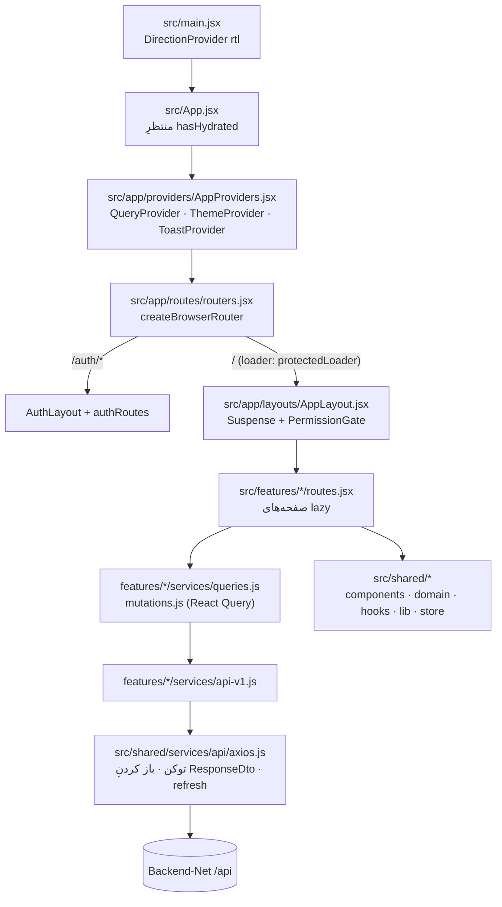

# معماری فرانت‌اند OurERP — نقطه‌ی شروع

این پوشه مستندِ معماریِ `Frontend/` است. همه‌ی مسیرها نسبت به `Frontend/` نوشته شده‌اند.
هر ادعا از روی کدِ فعلی نوشته شده؛ هر جا چیزی روشن نبود با `UNCLEAR:` علامت خورده است.

> قاعده: هر تغییرِ ساختاری (فیچرِ جدید، جابه‌جاییِ پوشه، الگوی تازه) باید فایلِ مربوط در همین پوشه را به‌روز کند.
> `node scripts/check-docs-paths.mjs` بررسی می‌کند همه‌ی مسیرهای ذکرشده در این اسناد واقعاً وجود دارند.

## از کجا شروع کنم؟

| سؤالِ شما | فایل |
| --- | --- |
| چه ابزارها و کتابخانه‌هایی؟ چطور اجرا/build کنم؟ | [01-tech-stack-and-tooling.md](01-tech-stack-and-tooling.md) |
| فایلِ جدید را کجا بگذارم؟ | [02-folder-structure.md](02-folder-structure.md) |
| صفحه/مسیرِ جدید اضافه کنم | [03-bootstrap-and-routing.md](03-bootstrap-and-routing.md) |
| ورود، توکن، refresh | [04-auth-and-session.md](04-auth-and-session.md) |
| مجوزِ یک صفحه یا دکمه | [05-permissions.md](05-permissions.md) |
| یک endpointِ بکند را صدا بزنم | [06-api-layer.md](06-api-layer.md) |
| query / mutation / invalidation | [07-server-state-react-query.md](07-server-state-react-query.md) |
| state سمتِ کلاینت (فیلتر، فرم، پیش‌نویس) | [08-client-state-zustand.md](08-client-state-zustand.md) |
| رنگ، تم، RTL، تاریخ شمسی | [09-ui-system-theming-rtl.md](09-ui-system-theming-rtl.md) |
| کامپوننتِ آماده‌ای برای X هست؟ | [10-shared-components-catalog.md](10-shared-components-catalog.md) |
| enum، وضعیت، منطقِ مرجوعی/پرداخت | [11-domain-layer.md](11-domain-layer.md) |
| یک ماژولِ کسب‌وکار (فروش، انبار، …) | [12-features/README.md](12-features/README.md) |
| دستورالعملِ گام‌به‌گام برای کارهای رایج | [13-recipes.md](13-recipes.md) |
| وابستگی‌ها، کد مرده، بدهی‌های شناخته‌شده | [14-dependency-graph-and-health.md](14-dependency-graph-and-health.md) |

**نسخه‌ی تعاملی:** [`architecture-map.html`](architecture-map.html) — همین محتوا با دیاگرام و شبیه‌ساز (لایه‌ها، مسیرِ درخواست، refresh، مجوز، گرافِ فیچرها، کش، بدهی‌ها). در مرورگر باز کنید. منبعِ حقیقت همین فایل‌های `.md` هستند؛ بعد از تغییرِ ساختار، صفحه را هم به‌روز کنید.

ترتیبِ پیشنهادیِ خواندن برای تازه‌وارد: 01 → 02 → 03 → 06 → 07 → 13، بعد فایلِ فیچری که رویش کار می‌کنید.

## تصویرِ کلی در یک نگاه

برنامه یک SPAِ React است (`src/main.jsx` → `src/App.jsx`)، کاملاً فارسی و راست‌به‌چپ، که فقط با
بکندِ ASP.NET (`Backend-Net/`) از طریقِ یک نمونه‌ی axios حرف می‌زند (`src/shared/services/api/axios.js`).

## مسیرِ یک درخواست، سر تا ته

مثال: کاربر به لیستِ مشتریان می‌رود.

1. **URL → روتر.** `src/app/routes/routers.jsx` همه‌ی آرایه‌های `*Routes` فیچرها را زیرِ مسیرِ `ROUTES.ROOT` با `AppLayout` جمع می‌کند.
   `customersRoutes` در `src/features/customers/routes.jsx` تعریف شده است.
2. **loader.** `protectedLoader` (`src/app/routes/protectedLoader.jsx`) اگر `useAuthStore.getState().sessionVerified` نباشد به صفحه‌ی ورود با `?from=` ریدایرکت می‌کند.
3. **گاردِ مجوز.** `AppLayout` (`src/app/layouts/AppLayout.jsx`) خروجیِ مسیر را در `<Suspense>` و `<PermissionGate>` می‌پیچد. `PermissionGate` (`src/app/routes/PermissionGate.jsx`) عمیق‌ترین `handle.permission` را (اینجا `"CustomerView"`) با `satisfies` از `src/features/auth/hooks/usePermission.js` می‌سنجد.
4. **صفحه.** `CustomersPage` به‌صورت `lazy()` بار می‌شود و فیلترها را از `useCustomerFilterStore` (Zustand) و داده را از `useCustomersQuery` می‌گیرد (`src/features/customers/services/queries.js`).
5. **query → api.** `useCustomersQuery` پارامترها را با `listQuery` از `src/shared/services/api/contract.js` می‌سازد و `fetchCustomers` از `src/features/customers/services/api-v1.js` را صدا می‌زند؛ کلید از `customerKeys` (`queryKeys.js`).
6. **axios.** interceptorِ درخواست `Authorization: Bearer` را از `useAuthStore` می‌گذارد؛ interceptorِ پاسخ پوششِ `{ Data, Message, ResponseMessageType }` را باز می‌کند و روی ۴۰۱ صفِ refresh را اجرا می‌کند (جزئیات: [04](04-auth-and-session.md) و [06](06-api-layer.md)).

## اسنادِ دیگرِ این مخزن

- `REFACTOR.md` — سندِ پیگیریِ ریفکتور (تاریخچه‌ی فازها). مرجعِ معماری نیست.
- `FEATURE-GAPS.fa.md` — فهرستِ کمبودهای فیچری نسبت به بکند.
- `README.md`ِ انگلیسیِ قدیمیِ `Frontend/` حذف شد (2026-10-16)؛ پر از ادعای نادرست بود (بکندِ Go، `services/api.js`، aliasِ `#/*`، …). راه‌اندازیِ عمومی در `CLAUDE.md` و فایلِ [01](01-tech-stack-and-tooling.md) است.
- `Backend-Net/docs/frontend-requests.fa.md` — درخواست‌های فرانت از بکند (فرانت کدِ بکند را تغییر نمی‌دهد).

